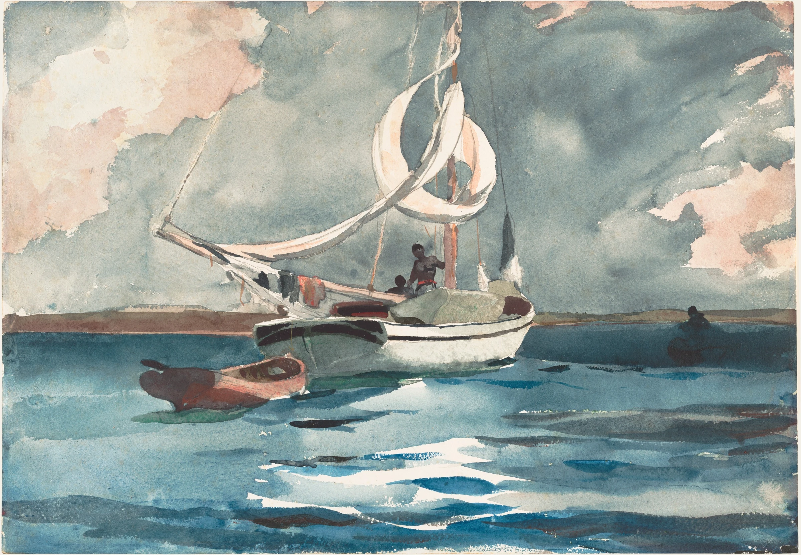

# wet-on-wet

Winslow Homer's *Sloop, Nassau* (1899) painted in front of you as you scroll,
in the order Homer worked. It starts as a sheet of warm white Whatman paper with
a pencil drawing on it. Clear water is swept across the sky and then the sea in
broad bands, and the colour runs in right behind it: a few broad, flat, pale areas
(rose, pale grey, slate, two blues) at about 40% of their final strength, joined by
feathered, branching edges where they met wet, with a hard, darker bead where the
water stopped on dry paper. The wash is darker and glossy while wet. It dries a shade
lighter and matte, with a darker rim against the reserved whites and pigment settled
in the paper's tooth. Then the wet-on-dry work, object by object, each finished
before the next begins: the sky's second wash with its cloud modelling, the far
shore, the hull, the sails' shadow side and rigging, the figures, the dinghy, and
the sea from the horizon down. Each object's mid-tones go on first as crisp strokes
laid from one end, and its darks follow. Last, the lights on the water are scraped
back to white paper, mark by mark. The final frame is the painting,
pixel for pixel. Scroll back and it un-paints.

```html
<link rel="stylesheet" href="wet-on-wet.css">
<section data-wet-on-wet data-src="assets/sloop.json">
  <div class="ww-stage">
    
  </div>
</section>
<script type="module" src="wet-on-wet.js"></script>
```

You can also `import { wetOnWet } from './wet-on-wet.js'` and call
`wetOnWet(section, { src, mode, runway, webgl })`. It returns `destroy()`.

## Options

| attribute     | option   | default  | what it does |
|---------------|----------|----------|--------------|
| `data-src`    | `src`    | required | The painting's JSON (size, paper colour, stage timings, camera tracks). Beside it go `<name>.webp` (the painting), `-wash.webp` (the first wash, dried), `-wet.webp` (the first wash in suspension, small and soft), `-mid.webp` (after the mid-tones), `-fill.webp` (the wash under the scraped lights, half size), `-lines.webp` (lossless: R pencil, G scrape mask, B the sheet's real edge) and `-mapa.webp` / `-mapb.webp` (lossless, half size: when each pass reaches each point). |
| `data-mode`   | `mode`   | `scroll` | `scroll`: a pinned stage on a runway. `static`: the finished painting as an image. |
| `data-runway` | `runway` | `350`    | Section height in svh. The stage is pinned for `runway - 100` svh of travel. |
| `data-webgl`  | `webgl`  | `on`     | `off` leaves the finished painting as an image. |

The stage timings are fractions of the runway, set in the JSON's `stages`:
wash 0.06-0.38 (drying 0.28-0.50), the wet-on-dry strokes 0.46-0.85 (sky 0-20% of
that, shore 20-28, hull 28-46, sails 46-60, figures 60-68, dinghy 68-78, sea
78-100), scraping 0.865-0.94, then the finished sheet.

Events (bubbling, so a sound can be wired to them later):
`wet-on-wet:stage` with `detail: { stage }` as each pass begins while
scrolling forward (`wash`, `strokes`, `scrape`), and `wet-on-wet:done`
when the last scrape is made.

## The real thing

What we read and modelled (Art Institute of Chicago, *Watercolors by Winslow
Homer: The Color of Light*, 2008, and its catalogue records: "rewetting,
blotting and scraping over graphite" on J Whatman paper; the Getty and Cleveland
notes on wet-into-wet and on Homer's scraped highlights; Curtis et al.,
*Computer-Generated Watercolor*, SIGGRAPH 1997):

- **Pencil first.** A light graphite drawing of the boats, the sails and the
  horizon. Here the lines are grey, broken by the paper's tooth, and their
  pressure wanders along the stroke. The washes run over them, and they are
  gone under the paint by the end, as in the original.
- **Wet-in-wet.** Clear water goes on in horizontal bands, top down, the
  direction alternating like a loaded brush. The wet paper is slightly darker,
  with a soft sheen. The colour runs in right behind the water in fine branching
  fingers, and where it stops at the edge of the wet area (dry paper beyond) it
  pools in a hard, darker bead that melts away when the next band joins it. A
  first wash is not a blurred copy of the finished picture: it is a few broad,
  flat, pale areas of colour, about 40% of the final strength, whose edges are
  feathered where two wet colours met. The whites of the sails and hull are
  reserved, and their edges stay crisp.
- **Drying.** The wash dries in the order it was laid, with the large mottle
  of the paper's sizing. It lightens and loses its gloss, and the dried state
  shows a darker rim where the wash met the dry paper of a reserve, and
  granulation in the tooth.
- **Wet-on-dry, one thing at a time.** Homer painted an object in one go. Each
  object's passes finish before the next begins: the sky's second wash (the
  cloud modelling, with the hard cloud edges of wet-on-dry), the far shore, the
  hull, the sails' shadow side and the rigging, the figures, the dinghy, then the
  sea from the horizon down. Inside an object, the strokes are laid from one end
  (horizontal strokes from the left, upright ones from the top). A fresh stroke
  is darker, smooth inside and glossy, and dries in a beat into its real texture
  and rim. The darks follow the mid-tones as a glaze. An object's region sits
  just inside its own edge, and the edge goes with the field around it, so a
  waiting object is never ringed by unpainted sky.
- **Scraping.** The lights in the water were scraped with a knife after the
  paint was dry. Each mark appears in a fraction of a second along its length,
  left to right, ragged where the tooth catches, and the paper under it is the
  real paper of the scan.

Simplified: the time it takes is compressed into scroll (a big wash takes
minutes and dries in ten). The order of objects follows what we know of how
Homer worked, but is not documented for this sheet. The split into passes is
computed from the finished painting, so it is a reconstruction (see below).
Blotting is not modelled as its own pass. The far figure in his boat is painted
with the shore and the sea, not with the figures on deck.

## How it works

**Offline (Python, scripts kept in the builder's scratch folder, not in the
component).** All of this works in linear-light optical density,
`D = -ln(colour / paper)`, so passes add the way transparent washes do.

1. *The sheet.* The Met's scan is cropped to the sheet. The sheet's real,
   slightly worn edge comes out as an alpha (background matched per side,
   notches closed, anti-aliased). Paper colour is taken from the brightest
   unpainted paper.
2. *Scraped lights.* Bright, paper-white marks in the water. A tight soft
   mask is made, and the wash under them is inpainted (normalised convolution
   at growing scales) and given texture copied from the sea nearby.
3. *The first wash.* The sky and sea field (boats and shore inpainted) is
   heavily smoothed, then posterised with k-means into three hues in the sky and
   two in the sea, and lightened to about 40% of each area's density (the
   palest, the rose, a little more so that it reads). Area boundaries are pushed
   about with fractal (fBm) displacement and given a soft core of about 2px, with
   a faint crinkled fringe. The reserved whites are cut out crisp. The dried
   state adds a darker rim (about 3px) against the reserves and granulation from
   a fine fractal grain. The wet state (`-wet.webp`) is the same areas without
   the rim or the grain.
4. *Mid-tones and darks.* What remains is laid as a glaze: each pixel's
   remaining density is capped at 0.62 (luminance optical density) for the
   mid-tone pass, and the darks deepen the rest.
5. *Pencil.* Contours of the reserved forms, Canny edges near the boats, and
   the horizontal edges of the far shore, de-duplicated, skeletonised, pruned,
   and rendered as a 2px graphite line whose pressure wanders (drawn at 78% darkness
   at full pressure, so the opening reads at a squint on a phone).
6. *Time maps (half size).* Water sweep (bands with wavy, noisy edges).
   Colour arrival: just behind the water, offset by fine fractal noise, so it
   runs in as branching fingers. Strokes: the sheet is split into objects (sky,
   shore, hull, sails and rigging, figures, dinghy, sea; masks from the reserves,
   GrabCut, the dinghy's red and the dark pass). Each object gets its own window,
   and inside it its mid-tone and dark layers are split by watershed into stroke
   pieces, ordered by band, filled geodesically from one end, and smoothed
   within the object only.
   Scrapes: each connected mark in turn, left to right. Camera tracks (the
   centroid of the work in progress through each pass) go in the JSON.

**In the browser.** One quad, one fragment shader (WebGL2, or WebGL1 without
the mip blur and the phone zoom). Per pixel:
`L1 = D(wash)`, `L2 = D(mid) - D(wash)`, `L3 = D(pre-scrape) - D(mid)`,
`Ls = D(pre-scrape) - D(O)`, and the shown density is
`c1·L1' + c2·L2' + c3·L3' - cs·Ls`, where `c` is each pass's coverage from its
time map (soft and feathered for the wash, crisp for strokes and scrapes) and
the primes are the wet looks (blurred, darker, glossy) easing into the real
layer as each part dries. The colour is `O · exp(-(D - D(O)))`. When every pass
is down and dry this is exactly `O`: the original painting, pixel for pixel.

- Images are resampled on the CPU to the size they are shown at, then
  mipmapped. The time maps are uploaded exact (unpremultiplied ImageBitmaps)
  and sampled linearly.
- Scroll is followed on a critically damped spring (quicker going back).
- The canvas draws the sheet itself: its real edge from the alpha, sharp and
  anti-aliased, with a tight shadow. No vignette.
- On a narrow screen the sheet fills the width, and from the pencil stage on
  the view goes in close (up to 2.1x, until the sheet fills about 70% of the
  height) and drifts after the work in progress. The camera path is a function
  of scroll only, smoothed along it. It pulls back to the whole sheet after the
  last scrape.

## Theming

| variable      | default         | used for |
|---------------|-----------------|----------|
| `--paper`     | `#f3f0e8`       | the page around the sheet (read from the section's background) |
| `--ww-gutter` | `var(--gutter)` | side padding of the stage (the demo uses 5px on phones so the sheet fills the width) |
| `--ww-runway` | set by the script | section height in scroll mode |

The sheet keeps the painting's own paper. The fallback `` has the page
colour composited outside the sheet's edge, so it sits on `#f3f0e8` without a
box. With a very different `--paper` the corners of the image will show.

## Accessibility and motion

- Without JS, without WebGL, or with `data-webgl="off"`, the finished painting
  is an ``. The canvas is `aria-hidden`. The art is ornament (`alt=""`),
  and credits are in `assets/credits.json`.
- Reduced motion: no runway and no canvas, only the finished painting. If the
  setting changes mid-visit, it settles on the finished painting.
- Phone: nothing is interactive, so a swipe always scrolls.
- There is no UI and no caption on the page. The piece is driven by scroll alone.

## Cost

- Assets 2.5 MB: painting 1.0 MB, mid-tones 0.8 MB, first wash 0.13 MB, fill
  0.2 MB, lines 0.08 MB, time maps 0.25 MB (lossless), wet 23 KB, JSON 4 KB.
- One full-screen quad, about fifteen texture reads per pixel. A frame draws
  only while the scroll spring is moving and the section is on screen
  (IntersectionObserver). Nothing runs when the scroll is still, off screen or
  in a hidden tab. DPR is capped at 2.

## Making another painting

The scripts (`s1_sheet.py` crop and edge, `s3_layers.py` scrape mask, fill and
masks, `s3b_wash.py` the posterised first wash and the glaze split, `s4_pencil.py`, `s5_times.py` time maps and camera, `s6_export.py`)
live in the builder's scratch folder. A new painting needs its own boxes: the
reserved whites, GrabCut rectangles around the dark objects, the far shore band
and the stroke groups. Look at the first wash and the mid-tone image at full
size before exporting. The mistakes show there: boxy edges, invented colours,
halos.

## Credits

Winslow Homer, *Sloop, Nassau*, 1899, watercolour and graphite on off-white
wove paper. The Metropolitan Museum of Art, Open Access (CC0). The separation
into passes, the pencil drawing and the time maps are ours. No third-party code.
