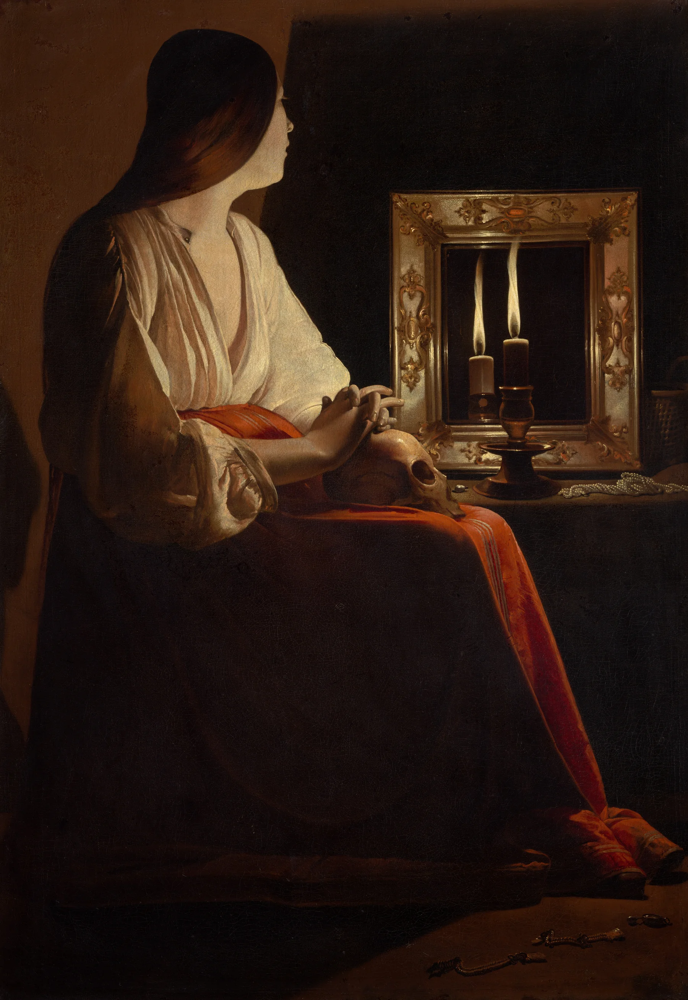

# candle-light

A candlelit painting whose candle is alive. Georges de La Tour's *Penitent
Magdalen* sits with a candle and its double in a black mirror. In front of the
real canvas both flames are still. Here they burn: the flame sways and
flutters and now and then stretches tall, and the painted light on her face,
chemise, hands and the skull breathes with it. A hand passing fast near the
flame (on a phone, a sideways swipe) is a draught. The flame lies over and
shortens and turns blue, the room dims, a thread of smoke climbs from the wick,
and over a couple of seconds the flame stands up again. Blow hard enough and it
goes out, the wick glows, then it relights itself with a small flare. The
reflection does all of this in sync, a little dimmer and softer. A faint warm
flicker falls past the frame onto the paper where the candle is: above and to
the right of the painting.

```html
<link rel="stylesheet" href="candle-light.css">
<figure data-candle-light data-rig="assets/magdalen.json">
  
</figure>
<script type="module" src="candle-light.js"></script>
```

Or call it yourself:

```js
import { candleLight } from './candle-light.js';
const destroy = candleLight(figure, { rig: 'assets/magdalen.json', flicker: .8 });
destroy.state;   // the flame's live state: g (draught), lean, h (height), b (brightness), out …
destroy();       // removes canvas, light spill, listeners, observers, loop
```

The `` is the real painting, so it is what shows without JS, without
WebGL, on a `file://` page (the rig can't be fetched there), or if the GPU drops
the context. Style the figure however you like: in the demo it is an ebonised
frame (padding and a dark background), and the canvas lies exactly over the img.

## Options

| attribute | option | default | |
|---|---|---|---|
| `data-rig` | `rig` | (required) | URL of the rig JSON (or the object itself). Its asset paths are relative to it |
| `data-flicker` | `flicker` | `1` | how much the flame breathes in still air. `0` = a perfectly steady flame |
| `data-draught` | `draught` | `1` | how strongly a passing hand or swipe pushes the flame |
| `data-relight` | `relight` | `1.8` | how strongly the painted light follows the flame (`k` below) |
| `data-warmth` | `warmth` | `1` | 0-1, how much the room warms as the flame dims |
| `data-spill` | `spill` | `1` | 0-1, the light falling past the frame onto the page. `0` = none |

The options object wins over the attributes.

## The rig

Made once, offline, from the painting (the script lives outside the component;
the steps are below). `magdalen.json`:

```json
{ "image": "magdalen.webp", "width": 1800, "height": 2614,
  "patch": { "src": "magdalen-unlit.webp", "x": .663, "y": .224, "w": .118, "h": .137 },
  "light": "magdalen-light.webp",
  "grain": { "src": "magdalen-grain.webp", "x": .655, "y": .215, "w": .135, "h": .155 },
  "source": [.747, .305],
  "flames": [
    { "x": .747, "y": .338, "h": .104, "w": .0187 },
    { "x": .696, "y": .355, "h": .097, "w": .0179, "gain": .94, "soft": .95, "reflection": true,
      "clip": [.642, .248, .851, .423], "occlude": [.730, .338, .765, .423] } ] }
```

All numbers are fractions of the painting. `x, y` is the wick, `h` the flame's
height (of the painting's height), `w` its widest (of the painting's width).
`grain` (optional) is the canvas's own texture round the flames. The second flame is optional; `clip` is the mirror glass it lives in and
`occlude` what stands in front of it (here the real candle). `source` is where
the light comes from for the lean.

To rig another painting: crop it to the painted canvas; mask each painted flame
(threshold on brightness in a column above the wick, measured row by row, then
dilated and feathered); fill the mask from the same rows a few flame-widths to
the side (dark backgrounds take this perfectly, craquelure and all); save just
that region, with the feathered mask as alpha, as the patch. For the light map,
take the painting's luminance (with the flame removed) times a falloff from the
flame, `1 / (1 + (d / 0.42 W)²)`, normalise, blur a little, and add a small soft
floor round the flame itself. Save it small (here 300 px wide) and grey. For the grain, high-pass the
full-resolution scan with the flames painted out (`(L - blur3px) / max(blur, 40)`),
fade it where the blurred image has a strong gradient (edges of the picture,
not the canvas), and save it at the plate's scale as grey, 128 = none.

## How it works

- **Plate.** The `` is drawn into a 2D canvas at exactly the WebGL canvas's
  device pixels, the inpainted patch on top, and uploaded as one texture: the
  painting with no flame in it, sampled one texel per pixel, so it is as sharp as
  the img it replaces.
- **Flame** (fragment shader), after de La Tour's own rather than a
  photograph's. In the flame's own frame (`v` up from the wick in flame
  heights): a bulb low down narrowing into a long ribbon; a crisp outline
  (a px or two, as his brush left it) with the translucency inside it: a dense
  core and a mantle the dark mirror shows through (opacity .96 falling to .62
  just inside the edge); a cream body
  `(.92, .81, .58)` (his flame samples at 230, 201, 137) with a muted core and
  gold rim, and faint vertical streaks (noise across the width, slow along
  it); a dark zone of unburnt vapour above the wick, brownish and nearly
  transparent inside a bright envelope, the wick in it, blue at the very foot.
  The top never closes: the column narrows to a fifth of its width and fades
  into a pale thread that wavers on up toward the top of the mirror, as both
  his flames do. Its spine carries a slow S, a sine climbing it at about a
  fifth of a cycle a second, so the top lags the base. The glow is small and
  faint and close. As the flame starves it shrinks, fades and turns blue.
- **In the paint, not on it.** The flame's colour (and its thread's) is
  multiplied by `1 ± 0.07-0.13` of the canvas texture (weave and craquelure,
  high-passed from the original scan round the mirror), stronger in the dense
  body. The texture is fixed to the canvas, so the flame moves under the
  cracks, as his does.
- **Flicker** (JS). In still air: four octaves of smooth noise (0.55, 1.9, 4.3,
  9.1 Hz) for a slow breath and a quicker flutter, and every 1.4-4.4 s a stretch
  (the flame grows 10-24% for half a second) or a dip. The light reaching the
  room is `brightness × (0.22 + 0.78 × height)`.
- **Relight.** Each pixel of the plate is scaled by `mix(1, level^k, influence)`
  where `influence` comes from the light map: the face, chemise, hands, skull,
  mirror frame and wax follow the flame, the dark wall barely does. Under
  `level < 1` the lit areas warm toward `(1, .84, .64)` (a smaller flame burns
  redder). When the flame leans, the map is read shifted the same way and the
  side it leans to is lit up to 20% more, so the lit edges seem to move. With
  the defaults the chemise swings by about 15% within a third of a second.
- **Draught.** Pointer velocity, weighted by a Gaussian of distance from the
  flame (30% of the painting's width for a mouse; on touch, anywhere on the
  painting counts at least 45%), above a threshold of 260 px/s (180 for touch),
  pumps a draught level `g` that decays over about two seconds. `g` drives a
  spring for the lean (ω 9.5, ζ 0.38: it whips over and settles back). The
  flame stays upright for its first fifth and lays over above it; its upper
  half tears with fast lateral noise that grows with height (7.5 and 15 cycles
  per flame height, at 13 and 23 rad/s), and gaps race up it so tongues
  separate and vanish. It shortens (down to a fifth), widens by half, its calm
  thread goes, and its brightness flickers hard (a third, at 11 Hz). Below
  half brightness, smoke. Past `g` 1.4 the flame goes out (an ember glows on the wick
  and fades); it relights after 1.1 s with a flare of +30% height.
- **Smoke.** A ribbon in the shader: emitted while the flame is starved, each
  height carries what left the wick `v / 2.2 s` earlier, so the thread rises
  and its end detaches when the emission stops. It goes up straight and thin,
  then waves (two travelling sines and noise, growing with height), widens,
  twists (two strands that cross) and fades. The draught carries it sideways.
- **Mirror.** The reflection shares every number with the flame (same time,
  same lean, same flutter: a mirror parallel to the picture keeps left and
  right), at 94% gain and slightly softer edges, clipped to the glass and hidden
  behind the candle standing in front of it. Its smoke is greyer.
- **Light leaving the frame.** Two absolutely positioned layers under the
  canvas: a `multiply` warm cast `rgb(255 194 124)` and a `screen` glow
  `rgb(255 140 52)`, each a circular inverse-square falloff centred on the
  flame's own page position (radius 0.95 of the painting's height), windowed so
  it never ends in a ring. So the paper to the right of and above the painting
  takes it, the far margin hardly at all, and the text below not at all (a
  candle's reach is a few feet). The canvas covers them over the painting
  itself. Each frame their opacity follows the flame's level, exaggerated
  (about 3x) so a change shows between frames 0.3 s apart, and they shrink a
  little as it dims. They are clamped to the page width: no sideways scroll.
  On a dark page only the glow is used.

## Tuning

At the top of `step()`: the flicker octaves and the stretch events. In
`onMove`: the speed threshold and the gain (`push * dt * 9`). In the shader's
`spine()`: the S (`.05`, `4.4`, `1.25`) and the tearing; in `flame()`: the bulb (`.36`), the neck, the dark zone, the colours; `thread()` for the calm smoke.
`--cl-spill-mul` and `--cl-spill-scr` (space-separated RGB) set the colour of
the light on the page; the strengths are in `layoutSpill()`.

## Theming

| variable | default | |
|---|---|---|
| `--cl-spill-mul` | `255 194 124` | the warm cast on paper (multiply) |
| `--cl-spill-scr` | `255 140 52` | the glow that lifts ink and the frame (screen) |
| `--accent` | clay | keyboard focus ring |

The spill blends with the page, so don't give the figure (or its ancestors up
to the page) `transform`, `filter`, `opacity < 1` or `isolation`, or it will
blend with nothing.

## Accessibility and reduced motion

- The img is decorative (`alt=""`); canvas and spill are `aria-hidden` and
  never take input.
- With motion allowed the figure is focusable (`role="button"`, a default
  `aria-label` unless you set one); Enter or Space breathes on the candle.
- `prefers-reduced-motion: reduce`: one still frame of the flame, upright,
  at rest, with the spill at rest. No flicker, no draught, no loop.
- `touch-action: pan-y`: a vertical swipe on the painting scrolls the page as
  usual; only a sideways swipe is a draught.
- Print shows the plain painting.

## Cost

- One full-canvas draw at 30 fps while the painting is on screen (a flame always
  moves). Off screen (IntersectionObserver) or in a hidden tab, nothing runs.
- DPR capped at 2. The shader is two texture reads and a little arithmetic per
  pixel, plus noise only inside the flames' boxes.
- Per frame the spill costs two opacity and transform changes (compositor only).
- Assets: 568 KB painting (which the page loads anyway), 21 KB patch, 23 KB
  map, 94 KB grain.

## Credits

Georges de La Tour, *The Penitent Magdalen*, ca. 1640. The Metropolitan Museum
of Art, Gift of Mr. and Mrs. Charles Wrightsman, 1978. Open Access, CC0.
Details in `assets/credits.json`. No third-party code.
