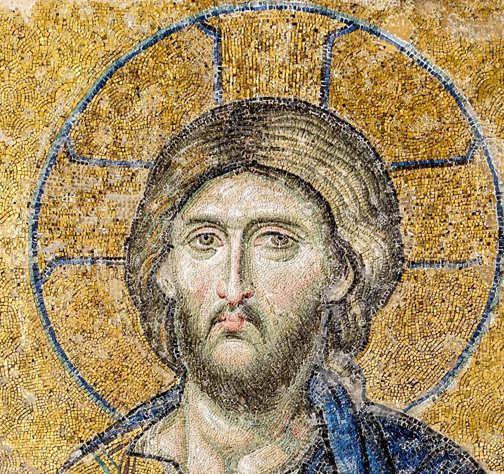

# gold-ground

A Byzantine gold mosaic that glints the way the real wall does. In Ravenna or
Hagia Sophia each gold cube is a tiny mirror set a few degrees off true, so as
you walk past, or a candle moves, single cubes flash and go out and a field of
separate sparks travels with you. Photographs flatten that away. Here the
photograph is only the colour: every real tessera in it was found, given its
own tilt and material, and lit again. Scrolling past moves your eye, the pointer
carries a candle, and on a phone tilting it moves the eye too.

```html
<link rel="stylesheet" href="gold-ground.css">

<!-- a strip of wall across the page; colour arrives as it reaches the middle -->
<figure data-gold-ground data-bloom class="gg-band">
  
</figure>

<!-- a panel at its natural ratio -->
<figure data-gold-ground data-distance="1.2" data-window=".7">
  
</figure>

<script type="module" src="gold-ground.js"></script>
```

Each image needs its baked tile data beside it, `<name>-tiles.png` (or name it
with `data-tiles`). The `` sizes the wall: leave it at its natural ratio,
or give the figure a height and the img `object-fit: cover` and any
`object-position`; the lighting takes exactly the same crop. Or call
`goldGround(figure, options)` yourself; it returns `destroy()`.

## Options

| attribute | option | default | |
|---|---|---|---|
| `data-tiles` | `tiles` | `-tiles.png` | the baked tile data (same origin) |
| `data-distance` | `distance` | `2.2` | how far away you stand, in screen sizes; the lights stand off the wall in proportion. Smaller = tighter pools of light that travel faster as you scroll |
| `data-candle` | `candle` | `1` | 0-2, the carried candle: it follows the pointer, and without one is held just right of the middle of the screen, so its pool walks along the wall as you scroll |
| `data-window` | `window` | `1` | 0-2, a broad window high and to the right, fixed to the church: a second, slower pool |
| `data-glow` | `glow` | `0.5` | 0-1, bloom round the brightest sparks; `0` skips the bloom passes |
| `data-bloom` | `bloom` | off | arrive greyed and warm into gold as the wall reaches the middle of the screen |

The options object wins over the attributes.

## Theming

| variable | default | |
|---|---|---|
| `--gg-floor` | `--paper-2` | behind the image while it loads |

`.gg-band` is a full-width strip, `min(92svh, max(52vw, min(72svh, 640px)))`
tall, with the image covering it. There is nothing else to theme: the colour is
the mosaic's and the light's.

## How it works

**Offline: finding the real tesserae.** (Python, scikit-image; the scripts are
not shipped.) The grout is a network of thin dark valleys between brighter
cubes, so a black-ridge filter (Sato, at the grout's width) is combined with a
white-ridge filter (in dark passages, hair and robes, the mortar reads lighter
than the glass) and a colour-edge term, each normalised by local contrast. What
is left once the joints are removed is the faces of the cubes; their distance
transform peaks once in the middle of each cube (h-maxima keeps one peak per
oblong cube), and a slightly compact watershed from those seeds fills each
cube out to its joints. Checked by drawing the region edges over the photograph
and inspecting 3x crops: in the gold ground the edges lie on the real grout,
cube by cube (Justinian's band: 21,400 cubes; the Deësis panel: 24,400).
Faces, where the cubes are smaller and the photograph softer, are rougher, so
they are given almost no specular and no edge shadow.

**Classification.** From each cube's median colour: gold (hue 28-64°, saturated,
not dark, and inside a gold neighbourhood, so flesh-coloured cubes in a face do
not count), silver or leafless glass (pale and unsaturated inside the gold),
coloured or dark glass, and stone.

**Setting.** Each cube gets a tilt drawn from a 2-D normal distribution:
σ ≈ 6° per axis for gold, 5° for silver, 3° for the rest. One cube in twenty
was set carelessly steep (σ 15°), and those are the lone sparks that catch far
from where the light falls. On top of that comes a systematic downward tip (3°
for gold), as in vaults set to meet people standing below. Gold gets smoother
surfaces than glass or stone. A cube is **confident** if its region is the size
and shape of one cube: between 0.3 and 2.6 times the median area, solidity
above 0.82 and eccentricity below 0.95. That holds for 74% of the gold in the
band and 86% in the panel. Everything is baked into one lossless RGB PNG at the
image's resolution:
- R, G: the normal's x and y (128 = straight out, ±127 = ±0.5).
- B: material in bits 7-6, confidence in bit 5, roughness in bits 4-0.

Neighbouring cubes always get different values, because the shader finds a
cube's edges wherever the value changes and so needs no separate edge map.

**Light: pools, not stars.** The light is a fragment shader that reads the data
nearest-neighbour.
- **Curved wall.** The wall is gently concave, like the inside of an apse
  (radius 8 × the viewing distance), so its surface normal turns slowly across
  the field. Each cube's own tilt rides on top of that.
- **Lights.** The eye is at the middle of the screen. There are two lights:
  - a candle, carried in screen space: it is at the pointer, or held just right
    of centre, near the wall;
  - a broad window that belongs to the church: high and to the right, fixed to
    the wall.
- **The pool.** Each light reflects as a Gaussian lobe on the half-vector. The
  lobe is about as wide as the spread of the setting (roughness 0.07-0.1, plus
  the size of the source). So where the mirror angle of the curved wall passes
  through the setting angle there is a pool: many cubes catch at once, at
  graded strengths, some full, many half, some dark. Outside it the catches
  thin out quickly to single steep cubes.
- **Movement.** Scrolling moves the wall under you and under the candle, so the
  candle's pool travels across the gold and breaks up differently cube by cube
  as it goes. The window's pool slides more slowly.
- **Uncertain regions.** A cube that is not confident gets only the pool's
  averaged light, computed on the wall's own curve with the lobe widened by the
  tilt spread, so it never flashes as a shard.
- **Materials.**
  - Gold mirrors the light gold-tinted, with a touch of white from the glass
    skin, so a peak goes nearly white.
  - Silver only glints where its segmentation is confident.
  - Coloured glass gets a faint, shapeless gloss on the macro curve; stone gets
    none.
- **Dark gold.** Gold that is not catching is darker and browner than the
  flash-lit photograph (bright-photographed gold more so). Each cube also
  reflects a slightly different part of a dim church, so the field is never
  even.
- **Rims.** A cube's rim loses its glint and takes a hair of shadow.
- **Bloom.** Highlights roll off to white. The light is computed again at half
  resolution; only light above 1.05 is kept, blurred twice each way and added
  back, so the hottest cubes in a pool glow.

## Tuning

`data-distance` sets the scale. Lights stand out from the wall at a fraction of
it, so a smaller distance gives tighter pools that move faster with scroll; the
panel uses `1.2`. Other places to tune:
- `setLight()`:
  - `uCurve`: how fast the wall turns; a smaller radius gives a narrower pool.
  - The window position, high and to the right of the wall.
  - The candle's height off the wall.
- The shader:
  - `wr` (lobe width) against the bake's `sig`: their ratio sets how full the
    pool is.
  - The candle and window intensities (`3.6`, `1.5`).
  - The gold base colour (how much deeper than the photograph it goes).
- The bake: the share of `wild` cubes sets how many lone sparks there are
  outside the pools.

New images: segment and bake offline (tile size in px is the one parameter
that matters; check the overlay), save the albedo and `-tiles.png` at the same
crop and size. The data texture must fit `MAX_TEXTURE_SIZE` (4096 is safe).

## Behaviour and cost

- **Draws only while something moves**: a scroll event, the pointer, the tilt,
  the candle easing to the pointer (~0.15 s) or the colour arriving (~0.35 s).
  Then the loop stops; nothing runs while idle, off screen or in a hidden tab.
- One full-resolution pass (10 data reads a pixel) and five half-resolution
  ones. Canvas DPR capped at 2, and never finer than the photograph itself.
- Assets: band 0.79 MB webp + 1.16 MB data PNG; panel 0.94 + 0.53 MB.
- Without JS, without WebGL, or if the data fails to load, the `` stays.
  On context loss the img shows until it comes back.

## Accessibility and reduced motion

- Decorative: `alt=""` on the img, the canvas is `aria-hidden`. Nothing to focus.
- Touch scrolling is never touched: the canvas takes no input.
- `prefers-reduced-motion: reduce`: one still frame in full colour with a fixed
  set of glints (eye a little above the middle, candle low and left), redrawn
  only on resize. Scroll, pointer and tilt do nothing.
- Print shows the plain image.

## Credits

See `assets/credits.json`.
- Justinian and his retinue, San Vitale, Ravenna (c. 547). Photograph by
  Ввласенко, CC BY-SA 3.0, Wikimedia Commons. The derived tile data is shared
  under the same licence.
- Christ, Deësis mosaic, Hagia Sophia (c. 1261). Photograph by Myrabella,
  public domain, Wikimedia Commons.
