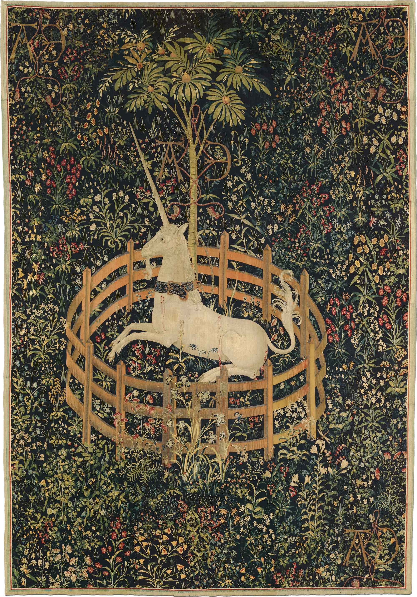
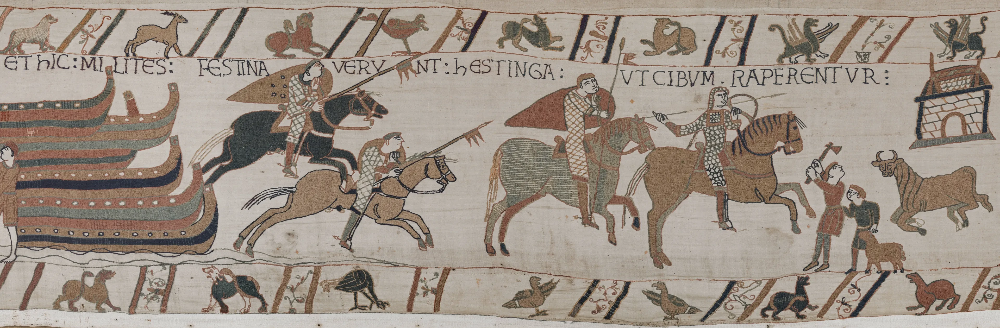

# hanging-tapestry

A woven hanging on a turned wooden rod with brass finials, hung by a cord from
one nail. The cloth is a real simulation, not a picture of one. It hangs in
soft folds that are darker in the valleys and carry a faint wool sheen. A slow
breeze keeps it barely alive, a fast scroll lifts the hem like moving air, and
you can take hold of it anywhere, pull a corner up to see the linen lining,
let go and watch it swing back and settle. A knotted fringe of warp ends hangs
from the hem. Wide images become a banner hung by fabric loops, sagging
between them.

```html
<link rel="stylesheet" href="hanging-tapestry.css">
<div style="width: min(100%, 600px)">
  <figure data-hanging-tapestry data-bloom>
    
  </figure>
</div>

<!-- a banner on loops, with tassels -->
<figure data-hanging-tapestry data-hang="loops" data-fringe="tassels" data-grain=".55">
  
</figure>
<script type="module" src="hanging-tapestry.js"></script>
```

The figure fills its container's width. The `` sets the cloth's
proportions, and the script pads the figure to make room for the cord and rod
above, the finials at the sides and the fringe below. To size it, size the
container. Give the img `width`/`height` attributes so the room is right
before it loads. You can also call `hangingTapestry(figure, options)` yourself;
it returns `destroy()`. An image with a transparent edge (like the unicorn,
cut out along its real bound edge) keeps that edge on the cloth.

## Options

| attribute | option | default | |
|---|---|---|---|
| `data-hang` | `hang` | `auto` | `rod`: the top is sewn into a sleeve around the rod. `loops`: hung by fabric tabs and draping between them. `auto` picks `loops` for images more than 1.8× as wide as tall |
| `data-loops` | `loops` | ~1 per 170px | number of tabs for `loops` |
| `data-fringe` | `fringe` | `knots` | `knots`: warp ends knotted in small bundles. `tassels`: a few bound tassels, dyed from the cloth's own colours. `none` |
| `data-breeze` | `breeze` | `1` | 0–2, the slow air that keeps it moving. `0` = still, and the loop sleeps once it settles |
| `data-bloom` | `bloom` | off | starts in black and white, then blooms into colour (~3s) once it has been properly in view for a moment |
| `data-grain` | `grain` | `1` | 0–1.5, the woven relief laid over the image. Use about `.5` for embroidery on plain linen |
| `data-lift` | `lift` | `1` | 0–2, how much a fast scroll lifts the hem |

The options object wins over the attributes.

## Theming

| variable | default | |
|---|---|---|
| `--ht-fringe-color` | sampled from the hem | colour of the fringe or tassels |
| `--accent` | clay | keyboard focus ring |

The rod, finials, cord and nail are drawn in walnut and brass and are not
themed. The tabs are made from the cloth's own top-edge colour, lifted toward
linen. The fringe is undyed wool tinted by the hem, and the tassels are dyed
from the cloth's mean colour, pulled toward madder and ochre. The shadow is a
warm umber.

## How it works

- **Cloth.** About 2,100 particles (39×56 on the unicorn), with
  Verlet integration at a fixed 120 Hz and five constraint passes per step:
  structural, shear, and a bend link across every two cells. Every particle
  also has a *tether* to its nearest pin, so however hard you pull, the wool
  never stretches like rubber. Gravity is scaled to the cloth's height, so a
  phone-sized hanging and a wall-sized one swing with the same slow ~2.7 s
  period.
- **Folds.** The sleeve gathers the cloth to 89% of its width, and each column
  wants to hang plumb from where it is sewn. The cloth is wider than the room
  it has, all the way down, so it buckles into a few broad folds whose line
  wanders. Nothing is drawn: pull it and the folds re-form wherever they like.
  The wall stops the cloth going behind it, with a little friction. On loops
  the tabs pin the top and the edge drapes between them.
- **Air.** Three slow travelling sines that gust, acting through each
  particle's normal (cloth catches air face-on). Scroll velocity lifts the hem
  and leans it out. A phone's tilt leans gravity sideways, and tipping the top
  toward you lets the cloth fall off the wall a little.
- **Shadow.** The cloth and fringe are projected onto the wall along the
  light, by how far each point stands off it, into a quarter-size buffer. That
  buffer is blurred twice and laid on the paper, so a lifted corner throws a
  longer, softer shadow. It fades out before the canvas edge.
- **Light.** Per-pixel light from the interpolated cloth normals. The diffuse
  is wrapped and normalised so that flat cloth shows the image exactly.
  Valleys darken by their curvature. A grazing sheen catches wool fibres. A
  procedural weave adds weft ridges (horizontal, as a tapestry is woven
  sideways) with brick-offset pips, per-pip and per-yarn-lot variation
  (abrash), and a slight bump in the normal. It fades out before it could
  alias (OES_standard_derivatives) and is kept faint at 1×. The back face is a
  plain linen lining.
- **Fringe.** One small rope per bundle, simulated with the cloth, drawn as
  thin lit strands that converge at a knot and open toward uneven tips.
  Tassels have a bound, domed head.
- **Image.** Drawn into a power-of-two texture about 1.3× the device pixels it
  covers, mipmapped, with anisotropic filtering where available, so the
  weaving stays sharp.
- **Hardware.** One SVG per size: a walnut gradient with wavering grain, turned
  brass finials (collar, bead, ball and point) with a glint, a twisted cord
  wrapped three times round the rod, a domed nail, and soft shadows.

## Tuning

The constants at the top of `hanging-tapestry.js` are the physics. `GATHER`
sets how deep the folds are (0.85 makes heavy curtain folds, 0.97 hangs almost
flat). `PLUMB` sets how strongly the folds persist down to the hem. `K_BEND`
sets fold width (stiffer gives broader folds). `DAMP` is air drag (lower
swings longer). `G_PER_H` is the weight. The fold count is `cw / 130` in
`buildCloth()`. The breeze's shape and strength are in `step()`
(`0.075 * g` out of the wall, `0.022 * g` sideways). The light direction is
`L`.

## Behaviour and cost

- With the breeze on, a light loop runs while the hanging is on screen: about
  2,100 particles and ~11,000 constraints × 5 passes at 120 Hz, plus four small
  draws. A laptop holds 60 fps with room to spare. On a mid phone, expect a
  few ms a frame. Off screen or in a hidden tab, nothing runs. With
  `data-breeze="0"` the loop sleeps about half a second after the cloth comes
  to rest, and a scroll, touch or key wakes it.
- The figure is padded for its hardware as soon as the module loads, and the
  cloth is built when it comes within 700px of the viewport. It is simulated
  to rest before it is first shown and crossfades in over the plain image.
- Canvas DPR is capped at 2, except on a 3× phone when the canvas stays under
  ~3.6 megapixels.
- **Without WebGL** (or with a cross-origin image) you get the image with the
  same rod, cord and finials, painted fold shading, a CSS fringe and a drop
  shadow. `data-bloom` then blooms with a CSS filter.

## Accessibility and reduced motion

- The image is decorative (`alt=""`), and the canvas and hardware are
  `aria-hidden`. The figure becomes `role="img"` with a default `aria-label`
  (set your own to describe the work) and is focusable. ← and → send a breath
  of air from that side, Enter or Space presses the cloth, and focus shows an
  accent ring.
- **Phones:** a vertical swipe on the cloth still scrolls the page
  (`touch-action: pan-y`). A sideways drag takes hold of it, and a tap pushes
  it against the wall. No long-press menu and no text selection.
- `prefers-reduced-motion: reduce`: the cloth is simulated to rest before it
  is shown, folds and all, and then nothing moves by itself. There is no
  breeze, no scroll lift and no tilt, and it is in full colour from the start
  (the bloom's end state). Dragging still works, damped so that it settles
  without swinging.
- Print shows the plain image.

## Credits

- *The Unicorn Rests in a Garden* (from the Unicorn Tapestries), 1495–1505:
  The Metropolitan Museum of Art, The Cloisters Collection, CC0.
- Bayeux Tapestry, scene 40: public domain, photograph by the Université de
  Caen Normandie / CNRS / ENSICAEN, via Wikimedia Commons.
- Details in `assets/credits.json`. The cloth model follows Thomas Jakobsen's
  *Advanced Character Physics* (Verlet with constraint projection) and Müller
  et al. on position-based dynamics and long-range attachments. No code is
  taken from either.
