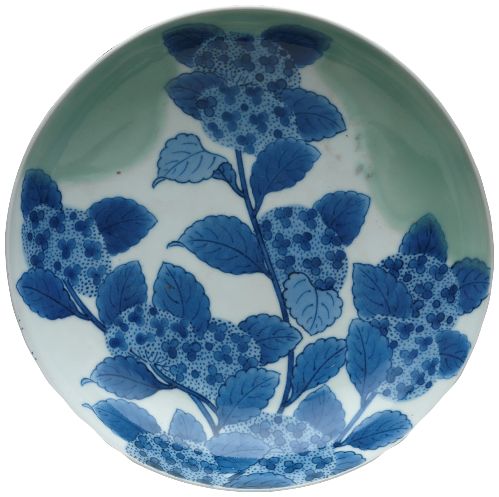
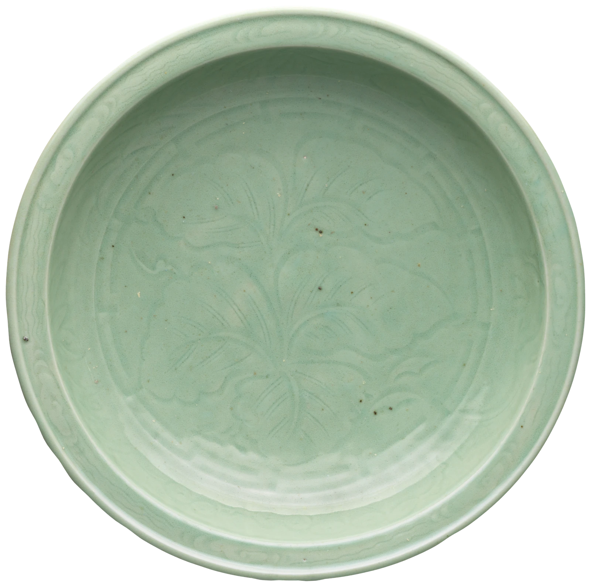

# kintsugi

A porcelain dish lying on the paper. Tap it and it cracks from where you
tapped, comes apart, and the pieces jump, tumble a little and slide to rest
around it, with a few chips. Tap again (or wait) and they lift and fly home
on springs, largest first; then gold lacquer runs out from the point of the
blow along every crack, fills the little piece that was lost, and sets. The
seams catch the light as you move the pointer (or tilt the phone). Made for a
404 page, an error state, or a reveal: broken, and mended.

```html
<link rel="stylesheet" href="kintsugi.css">
<figure data-kintsugi>
  
</figure>
<script type="module" src="kintsugi.js"></script>

<!-- already mended: the gold seams only, nothing breaks -->
<figure data-kintsugi data-state="mended" data-pieces="9">
  
</figure>
```

```js
import { kintsugi } from './kintsugi.js';
const destroy = kintsugi(figure, { pieces: 18, mend: 'tap' });
figure.addEventListener('kintsugi:state', (e) => { /* e.detail.state, .from, .event */ });
destroy.strike(0.2, -0.3);   // break it, the blow at that point (dish radius = 1); no args = anywhere
destroy.mend();              // gather and gild now
destroy.state;               // 'whole' | 'breaking' | 'broken' | 'mending' | 'gilding' | 'mended'
destroy();                   // remove everything, the plain  again
```

The image must be a transparent cut-out of a round(ish) dish or bowl
photographed from above, trimmed close. Its alpha is read once to find the
rim, so any such cut-out works. Without JS (or if the image fails) it is that
image, lying in the middle of a sheet of paper.

## How it breaks

- **The fracture** is a Voronoi diagram cut from the dish's outline, seeded
  the way a struck dish breaks: three to six main wedges around the impact at
  uneven angles (gaps drawn from a skewed spread, so one wedge is often much
  bigger), each seed at a different distance from the blow so the cracks miss
  each other there rather than meeting in a star; then a few secondary seeds,
  mostly further out along a wedge (a branch or a partial arc), occasionally a
  small piece near the blow. No rings, no centred crushed polygon.
- **The lost piece**, on most hard breaks, is an irregular sliver along one
  crack near the blow: a lens carved out of the shard on one side only (the
  other keeps its edge), which flies off with the chips; its gap is later
  filled flush with gold.
- **The cracks** are those straight bisectors bent by one smooth noise field
  (a long drift, a middle wobble and a fine tremor), so two neighbouring shards share the
  same ragged edge exactly and fit back together to the pixel. Vertices are
  snapped and each crack is subdivided once, so both sides are identical.
- **Each shard** is the photograph clipped to its polygon, taken from a copy
  of the photo made at the screen's own resolution (so a shard is never
  softer than the dish), with the porcelain body as a white line along every
  broken edge and a hair of shade inside it.
- **Physics** (2.5D): shards leave the blow with speed falling off with
  distance (small ones faster), jump, spin and tilt, land with a little
  bounce and slide to a stop on the paper. Tilt foreshortens the shard,
  shows its white thickness on one side, and lights or shades its face; the
  cast shadow grows softer and fainter with height. Pieces on the paper push
  each other apart rather than stack, and the sheet's edges stop them.
- **Mending**: each piece lifts, flies home on a slightly underdamped spring
  (no bounce), comes down onto its place as it arrives, and seats exactly;
  the chips and the lost piece fade. For a moment the dish is whole with its
  cracks still white and a hole where the lost piece was.
- **The gold** runs from the impact through the crack network: a shortest-path
  flood over the crack graph (it can jump through the glaze to the nearest
  crack at a cost), with a tapered, bright wet tip at each front. It fills the
  hole flush. Each seam is a ribbon of irregular width (urushi laid by hand),
  with small pools where three cracks meet, a hair of red lacquer at its edge,
  a broad sheen across the dish toward the light, and per-segment ridge
  light: a highlight on the side facing the light, strongest where a seam
  runs across it and near the pointer. Gold dust sits beside the seams, each
  speck a facet that flashes as the light comes round to it. One slow pass of
  light when the gold has set; after that the light follows the pointer
  anywhere on the page, or the phone's tilt.
- **Breaking it again** (tap the mended dish) bakes the first repair into the
  photo, so the old gold goes with the new pieces.

The behaviour is a small statechart (`CHART`, exported) run by a twenty-line
interpreter; the state is mirrored to `data-phase` (the input `data-state` is
left alone):

```
 whole ─STRIKE→ breaking ─SETTLED→ broken ─MEND→ mending ─SEATED→ gilding ─GILT→ mended
                  └─────── MEND (tap mid-air: they turn back) ───↗              │
                  ↖──────────────────────── STRIKE (break it again) ─────────────┘
```

## Options

Data attributes, or the options object (which wins).

| Option | Attribute | Default | |
|---|---|---|---|
| `src` | `data-src` | the img's own | Image, or a comma-separated list: one is picked at random per visit. |
| `state` | `data-state` | `whole` | `mended`: start mended (seams only, not a button unless `data-break` is set). |
| `pieces` | `data-pieces` | `8` | About how many shards (4–30): three to six main wedges plus branches. Already-mended dishes use at most 6. |
| `break` | `data-break` | `tap` | `view`: breaks by itself the first time it is well into view. `none`: never. |
| `mend` | `data-mend` | `auto` | `auto`: mends after `pause` on its own (a tap mends sooner). `tap`: waits for a tap. |
| `pause` | `data-pause` | `1600` | ms the pieces lie on the paper before `auto` mends. |
| `seed` | `data-seed` | random | A number gives the same fracture every load (stills, tests). |
| `size` | `data-size` | from `--kt-size` | Dish diameter as a share of the sheet's shorter side. |
| `label` | `data-label` | `Break the dish` | Accessible name while whole or mended. |
| `mendLabel` | `data-mend-label` | `Mend it with gold` | Accessible name while broken. |
| `announce` | `data-announce` | `Mended with gold.` | What the live region says when the gold has set. |

## Theming

| Variable | Default | |
|---|---|---|
| `--kt-gold` | `#c9a04a` | The gold's mid tone. |
| `--kt-gold-deep` | `#6e4c16` | Gold in shadow. |
| `--kt-gold-light` | `#fff1c6` | Its highlight and the dust's flash. |
| `--kt-lacquer` | `#7a2818` | The red urushi showing at the seam's edge. |
| `--kt-body` | `#fbf9f4` | The porcelain body in a break. |
| `--kt-size` | `.7` (phones `--kt-size-narrow`, `.72`) | Dish diameter / the sheet's shorter side. Smaller leaves more paper for the pieces. |
| `--kt-aspect` | `16 / 10` (phones `--kt-aspect-narrow`, `1 / 1.1`) | The sheet's shape: the area the pieces scatter over. |

Also uses `--ink-2` for the focus ring. Colours are read once at start.

## Tuning notes

- Constants at the top of `kintsugi.js`: the crack beat 150ms, the gold's run
  2300ms, the light's pass 1500ms, 70ms between shards lifting. Physics is
  in dish radii and seconds (`G`, the speeds in `shatter()`, the springs in
  `stepMend()`), so it reads the same at any size.
- The seam is 1.55% of the radius wide on average (about real kintsugi on a
  25cm dish), never under a CSS pixel and a half.
- The sheet (`.kt`) has `contain: inline-size` so the 1600px photo never
  props a grid open; give it a width from its parent as you would an image.
- Images: about 1600px, webp with alpha, cut out cleanly (the demo's were
  made with GrabCut and a smoothed polar outline, pulled in a few pixels so
  no grey fringe survives, and the shadow under the foot trimmed). A dish
  photographed straight down reads best; a slight angle is fine.
- rAF runs only while something moves and the sheet is on screen: the break,
  the mend, the gold's run, the light easing toward the pointer. At rest
  there is no loop. On a phone with tilt the loop stays awake while the
  mended dish is on screen but only repaints when the light actually moves.

## Accessibility and reduced motion

The figure becomes a button (`role="button"`, focusable, labelled "Break the
dish", then "Mend it with gold"); Enter or Space breaks and mends, and a
press while the pieces are still flying turns them back. While they are
gathering and gilding it is `aria-disabled`. A polite live region says
"Broken." and "Mended with gold." The focus ring is a hairline circle round
the dish. Canvas and ring are `aria-hidden`; the image itself is decorative
(`alt=""`); if the dish means something on your page, label the figure.
A tap starts nothing but a break: no drag, so a finger scrolling over the
sheet just scrolls (`touch-action: manipulation`).

Reduced motion: the dish is shown already mended (the gold set) and nothing breaks; the gold still answers the pointer, which is
direct feedback, not motion of its own. `data-state="mended"` dishes are the
same and are not buttons.

## Credits

No libraries (`tilt.js` is the house helper, copied in). The dishes are from
The Metropolitan Museum of Art's Open Access collection (CC0): *Dish with
Hydrangeas* (Japan, Nabeshima type, ca. 1690–1730), *Large Dish with Plants*
(Japan, Arita ware, 1640s) and *Bowl with two fish* (China, Longquan ware,
13th century), cut out from their grey grounds. See `assets/credits.json`.
