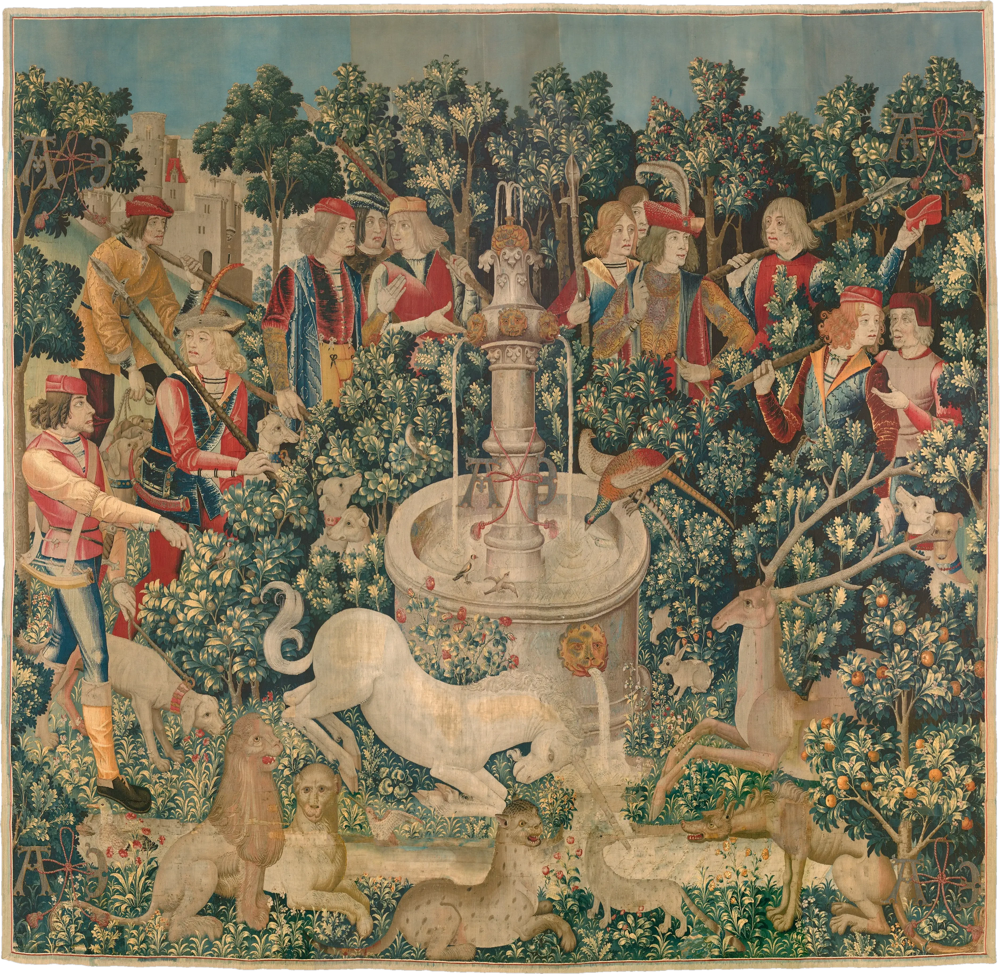

# loupe

A round reading glass lying on a print. The artwork sits on the paper in black
and white; the glass shows it in full colour and magnified, with the optics of
a real lens: the picture bulges toward the rim, faint colour fringes appear
only at the very edge, a thin bright edge catches the light from the top left,
the rim shades the print just inside it, and a soft shadow falls on the page.
It trails the pointer on a spring, lifts a little when you move fast, and when
you leave it drifts back to its resting spot and settles a touch smaller.

```html
<link rel="stylesheet" href="loupe.css">
<figure data-loupe data-zoom="2.4" data-rest="0.58,0.66">
  
</figure>
<script type="module" src="loupe.js"></script>
```

Or `import { loupe } from './loupe.js'` and call `loupe(figure, opts)`; it
returns `destroy()`. Keep `tilt.js` beside `loupe.js` (phone tilt).

| option | attribute | default | |
|---|---|---|---|
| `zoom` | `data-zoom` | `2.4` | starting magnification |
| `zoomMin` / `zoomMax` | `data-zoom-min` / `data-zoom-max` | `1.5` / `5` | wheel and +/- limits (see sharpness below) |
| `radius` | `data-radius` | `15vmin` | lens radius in `px` or `vmin`; never under 76px, never over 42% of the image |
| `mono` | `data-mono` | `1` | `0` leaves the print in colour too |
| `rest` | `data-rest` | `0.5,0.5` | where the glass lies when nobody is using it, 0..1 across and down |
| `src` | `data-src` | the `` | a bigger file for the lens than the page shows |

## How it behaves

A small state machine: **rest** (nobody using it: lies at `data-rest`, 88%
size), **follow** (a mouse or pen hovers: trails the pointer), **drag** (a
finger holds the glass: it lifts and floats above the fingertip, so the finger
never covers what you are looking at), **placed** (put down by a finger, a tap
on the print, or the keyboard: it stays). In rest and placed, tilting a phone
glides the glass across the print around where it lies.

- **Wheel** zooms only once the pointer has actually moved over the print, so
  scrolling the page past it never gets caught. At a limit, the next wheel
  gesture belongs to the page again. Trackpad pinch (ctrl+wheel) always zooms.
- **Sharpness.** The lens samples the full file as a mipmapped WebGL2 texture.
  The highest zoom is further capped so the file is never shown blown up more
  than 1.3x its own pixels at the screen's density (on a 2x laptop with the
  3755px tapestry at ~740px wide that is about 3.2x). Give it a big file.
- The glass may hang off the image onto the paper (it then magnifies paper),
  but never past the page's sides: no sideways scroll on a phone.
- Transparent images work: the glass shows paper through them. In the demo the
  tapestry's photo background is cut away so its woven edge lies on the page,
  and the Haeckel plate's white paper is made transparent (colour to alpha) so
  the glass never shows a stark white disc. Do the same for any scan on white.
- The stage the glass draws in reaches about 1.45 radii above and below the
  image. If the figure is the last thing on a page, leave that much room under
  it or the page grows a little.

## Theming

`--paper` (what the glass shows past the image's edge; read once at start),
`--ink` (shadow colour), `--ink-2` (focus ring, zoom readout), `--sans`.
`--lp-paper` overrides the paper the glass sees. `--lp-mono` replaces the
print's filter (default `grayscale(1) contrast(1.07) brightness(1.02)`, with
`mix-blend-mode: multiply` so the print sits in the paper).

## Tuning

In `loupe.js`: `MOVE` is the follow spring (`k` stiffness, `c` damping;
150 / 22 is a little under critical, so it trails and settles with a hair of
overshoot). `REST_SCALE` is the resting size. `LIGHT` is the light direction.
In the shader: `f = 1 + 0.07 d^2 + 0.30 d^12` is the barrel distortion (raise
the second term for a thicker lens), `ca` the rim colour fringes, `drop` and
`contact` the two shadows.

## Accessibility and reduced motion

The `` and its `alt` stay; the lens, shadow and readout are
`aria-hidden`. The figure is focusable with a visible ring and a description:
arrow keys move the glass (Shift for bigger steps), `+`/`-` zoom, `0` resets
the zoom, `Home` returns it to rest. Magnification changes are announced
(`aria-live`). Reduced motion: the glass is drawn where it lies (and stays there when the pointer leaves), follows the
pointer or finger directly with no spring, lift or drift, zoom jumps, and tilt
is ignored. Without WebGL2 a CSS lens takes over (round, colour, magnified,
shadowed, no distortion). Without JS it is the plain image, in colour. The
loop stops when the glass is still and when the figure is off screen; canvas
DPR is capped at 2.

## Credits

Spring feel after Poimandres' react-spring. No libraries. Images from
Wikimedia Commons, see `assets/credits.json`.
