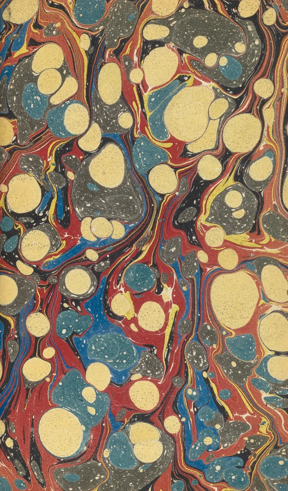
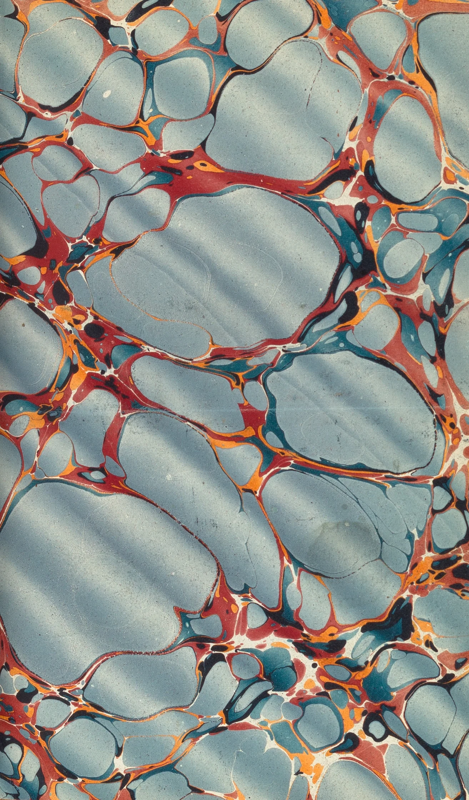

# marbling

A marbler's bath. Tap to drop ink and it opens on the size, pushing every
earlier colour aside. Drag to pull a stylus through it, or draw a comb of
tines across to get the feathered rows of a nonpareil. Then lay paper: a sheet
comes down top edge first, rolls onto the bath, peels away, turns over in the
air and settles face up with the print on laid paper, mirrored the way a
contact print is. The bath is left clear. Every ink is a vector polygon, so
the pattern stays sharp at any size and saves as PNG or SVG.

```html
<link rel="stylesheet" href="marbling.css">
<figure data-marbling data-preset="stone">
  
</figure>
<script type="module" src="marbling.js"></script>
```

A hero that composes a pattern by itself and holds it:

```html
<figure data-marbling data-autoplay data-preset="peacock">
  
</figure>
```

Without JS the figure shows its ``. The two in `assets/` are real marbled
endpapers from an 1856 bookbinding manual. You can also call it yourself:

```js
import { marbling, compose, INKS } from './marbling.js';
const m = marbling(figure, { preset: 'nonpareil' });
m.drop(500, 300, 'madder');      // bath units: the bath is 1000 wide, m.bath.H tall
m.comb('down');                  // 'down' | 'up' | 'right' | 'left'
m.play('spanish');               // stone | nonpareil | spanish | peacock
m.score([{ t: 0, op: 'drop', x: 500, y: 400, r: 80, ink: 'indigo' },
         { t: 1, op: 'comb', dir: 'right', spacing: 30, alpha: 50, lambda: 3, dur: 2 }]);
await m.lay();  m.png();  m.svg();  m.clear();
m.state;                         // 'bath' | 'laying' | 'print'
m();                             // destroy: listeners, observers, loop and added DOM
figure.addEventListener('marbling:print', (e) => e.detail.png().then(...));
```

Events (both bubble): `marbling:print` fires when a sheet has been lifted,
with `detail.canvas` (the print), `detail.png()` (a Promise of a Blob) and
`detail.svg()` (a string). `marbling:change` fires when a drop, stroke, comb
or pattern finishes, with `{ inks, vertices }`.

## Options

Data attributes, or the options object (which wins).

| Option | Attribute | Default | |
|---|---|---|---|
| `preset` | `data-preset` | none (`peacock` with autoplay) | Compose a pattern when the bath is first seen: `stone` (Turkish stone, with gall-water speckles), `nonpareil`, `spanish` (Spanish wave), `peacock` (bouquet). |
| `autoplay` | `data-autoplay` | off | Compose slowly by itself and hold. `loop` holds, lays paper, shows the print, then composes the next pattern. Hides the tool bar unless `controls` says otherwise. |
| `controls` | `data-controls` | `full` (`none` with autoplay) | `none` for a bare bath. |
| `palette` | `data-palette` | `aged` | `bright` for the fresh pigments. |
| `fine` | `data-fine` | `2.4` (`1.3` with autoplay) | How fine presets are against the sheet: drops this many times smaller (and k² as many), combs this many times tighter. `1` is bold; 2-3 matches real 19th-century papers. |
| `inks` | `data-inks` | the seven below | Comma list of CSS colours to use instead. Presets map onto them in order. |
| `tempo` | `data-tempo` | `1` (`0.4` with autoplay) | Speed of presets. |
| `hold` | `data-hold` | `9` | Seconds a `loop` holds a finished pattern before laying paper. |
| `seed` | `data-seed` | random | Same pattern on every load (stills, tests). |

The palette is aged to match the 1856 papers: indigo `#2f4862`, brick madder
`#9a4434`, dull ochre `#c09852`, sap verdigris `#5a7865`, Spanish grey-blue
slate `#7f949b`, iron-gall black `#352d2a` and cream `#e3d3a2` (exported as
`INKS`; the fresh set is `BRIGHT`). Taps cycle through it; the ring
in the tool bar marks the next ink, and tapping a swatch chooses it.

## Theming

| Variable | Default | |
|---|---|---|
| `--mb-size` | `#dbd4c4` | The empty bath (the size). Gall-water speckles show this colour. |
| `--mb-paper` | `#f5f0e3` | The sheet. The print's unprinted ground is this, a little dulled by size. |
| `--mb-tray` | `var(--paper-2)` | The tray's rim. |
| `--mb-rim` | `clamp(8px, 1.2vw, 12px)` | Rim width; `0px` for an edge-to-edge hero (the demo also drops the stage's border). |
| `--mb-aspect` | `4 / 3` | Bath shape on wide screens. Or give `.mb-bath` a height and `aspect-ratio: auto`. |
| `--mb-aspect-phone` | `4 / 5` | Bath shape at 560px and below. |
| `--mb-grain` | `.55` | Strength of the size's grain over the inks. |
| `--mb-bg` | `var(--paper)` | What the tool bar sits on (the gap in the selected ink's ring). |

Also uses `--ink`, `--ink-2`, `--ink-3`, `--rule`, `--accent`, `--paper-2`, `--sans`.

## How it works

Aubrey Jaffer's *Mathematical Marbling* (2012). Every ink is a closed polygon
in bath units, and every action is a map of the plane that every vertex goes through:

- **Drop:** `P' = C + (P - C) * sqrt(1 + r^2 / |P - C|^2)`. Area is
  conserved, so the rings around a new drop get thinner as it opens. Two
  steps at the same centre compose exactly (r² adds), so a drop spreads over
  a few frames by growing r² along an exponential ease. Holding feeds it.
- **Comb:** the tine line, `P' = P + M * alpha * lambda / (d + lambda)`, with
  `d` the distance to the nearest tine. To animate it, the comb's front
  sweeps across as a logistic window in `s = P·M`. Each frame solves every
  vertex's pre-image with two Newton steps, so the pass ends exactly at
  Jaffer's map and the pattern moves only where the comb is.
- **Wavy comb:** the same comb conjugated by a sinusoidal shear (straighten
  the tines, comb, bend them back). Exact and area preserving.
- **Spanish wave:** a sinusoidal shear, `P' = P + M * A * sin(2π P·N / L)`.
- **Stylus:** a single moving tine. It uses the same `lambda / (d + lambda)`
  across its path and a Gaussian along it, in steps of a third of its reach.
- **Far field:** a drop's push falls off as r²/2d, so it is faded out smoothly
  between 5 and 10 radii, and inks beyond that skip it. A fine stone of
  ~1,900 drops then costs about what a few dozen would.
- **Gall water:** a drop of nothing. It is an ink filled with the ground (the
  size in the bath, the paper on the print), which is how the stones get
  their pale speckles.

Edges are refined as they are mapped. An edge whose image comes out longer
than 2.4 css px is split at the midpoint of its pre-image, and that midpoint
goes through the map exactly. So a drop landing on a line opens it into a
true circle and no chord tears through. Edges shorter than half that are
merged. Edges outside the bath are kept 8× coarser, and inks pushed wholly off
it are dropped. Maps queued in one frame run as one composite pass. Inks out
of a comb's or stylus's reach are skipped, and concurrent drops share one
tight loop. Inks are drawn oldest first with quadratic curves through edge
midpoints. Each is also stroked a hair wide in its own colour, which hides
antialiasing seams.

**Ink body.** Pigment floating on size is never a flat fill. Each ink is
filled a second time with a tile of periodic noise: soft mottling plus a
granulation of about a css pixel a grain. The tile is offset per ink, so
neighbours differ. It is built at 3 px per css px, so it is sharp at DPR 3,
and it moves luminance only 2-6%. Stone and Spanish drops also get a
hairline darker rim (the veined edge). The texture and rims are raster only;
the SVG stays clean vectors.

The print is drawn into a generated sheet of laid paper: cloudy formation,
laid and chain lines, fibres and grain, at device resolution, so it is never
upscaled. The inks are multiplied in, mirrored, and the paper's tooth is
soft-lit back over them. While the sheet lies on the bath, the ink soaks
through behind the contact line, blurred and faint.

## Tuning

- `SEG` (2.4 css px) sets smoothness against vertex count. `BUDGET`
  (110k vertices) is where edges start to coarsen. At `fine` 2.4 on a
  desktop bath, a stone runs ~95k vertices and 1,400 inks, and combed
  patterns run 110-180k. A phone bath is about half that.
- The presets are in `compose()`, in fractions of `S = sqrt(W * H)` so they
  fit any bath shape. A ground needs about two and a half to three bath-areas
  of ink to cover the surface (coverage goes like `1 - e^(-A/bath)`). The
  stone starts with a flood of big drops that later colours squeeze into veins.
- Comb: `spacing`, `alpha` (how far ink at a tine travels), `lambda` (how
  sharp the tongues are). Keep `sigma` ≥ `alpha / 4` (it is set from alpha)
  or the front's inverse stops being unique.
- Stylus: `lam`, `sig` and the gain in `stepStroke`.
- Lay-paper timings are in `layPaper()`: down 0.9 s, roll 1.1 s, rest
  0.5 s, peel 1 s, turn 1.25 s, settle 0.5 s.

## Behaviour and cost

- The loop runs only while something moves: a drop spreading, a comb, a
  stroke, a pattern composing. At rest nothing runs. Off screen it pauses,
  and composition time does not pass.
- At `fine` 2.4 and DPR 2 (headless Chrome on a laptop), a preset costs a
  median 12-17 ms a frame with a p90 of 30-37 ms during its drop flurry.
  Drawing is 2-4 ms. Lower `fine` for a cheaper, bolder pattern.
- With reduced motion, a preset is computed in 14 ms slices per frame without
  being drawn (a fine one is seconds of work), then shown finished.
- Prints are drawn into memory-backed canvases (`willReadFrequently`), so a
  GPU reset cannot blank them. If the GPU drops the bath's canvas, it redraws
  when the canvas comes back.
- Canvas DPR is up to 3 while the bath stays under 3.6 megapixels, so a phone
  gets its full 3×. A large desktop bath drops to 2. Every edge is a vector, so
  it is sharp either way.
- PNG saves 2400 px on the long side (or the print at its own resolution).
  SVG holds every polygon (about 1-2 MB for a combed pattern).

## Accessibility and reduced motion

- The bath is focusable (`role="application"`, described by hidden help
  text). Enter or Space drops ink at a cursor. The arrows move the cursor
  (Alt for small steps). Shift with an arrow pulls the stylus. C combs and P
  lays paper. The cursor shows as a ring when focus is from the keyboard.
- Every tool is a real button, and the inks are a radio group with each
  pigment's name. A polite live region says what happened ("Madder
  dropped.", "The print is lifted. The bath is clear.").
- **Phones:** the bath never traps the page. A tap drops ink. A sideways drag
  pulls the stylus. An up or down drag scrolls the page (`touch-action:
  pan-y`). **Draw** (shown only on touch screens) frees the stylus in every
  direction and outlines the bath in the accent until it is switched off.
- `prefers-reduced-motion: reduce`: presets and autoplay show their finished
  pattern at once, drops open at full size, combs land complete, and the
  paper prints with no flight. The stylus still follows the finger, since
  that is direct manipulation. Loop autoplay does nothing on its own.
- Print styles hide the tool bar.

## Credits

- Mathematics after Aubrey Jaffer, *Mathematical Marbling*
  (people.csail.mit.edu/jaffer/Marbling). No code from it is used. No libraries.
- The fallback and demo images are two marbled endpapers from James B.
  Nicholson's *A Manual of the Art of Bookbinding* (Philadelphia, 1856),
  The Metropolitan Museum of Art, Open Access (CC0), cropped to the sheet.
  See `assets/credits.json`.
