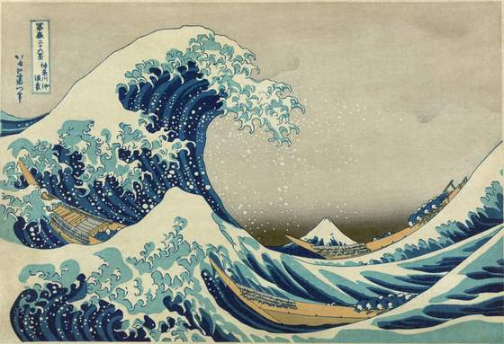
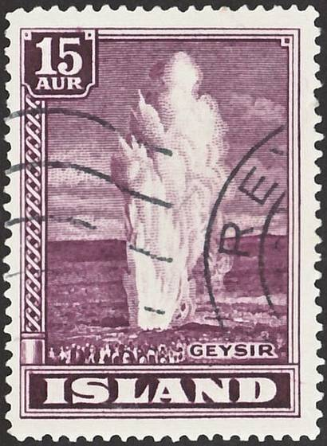

# moodboard

A pinboard for collecting pictures: paper prints on an endless sheet of board you can
pan and zoom like tldraw or Figma. On arrival the prints lie in a pile and are dealt out
into a loose cluster. Pick one up and it rises off the board and hangs from your finger,
swinging with your speed. Throw it and it slides on and stops the way paper stops on
paper. Pin it with a brass pin and it won't leave; pull it and it swings about the pin.
Edges snap to other cards with thin clay guides, and **Tidy** files everything into a
justified gallery sorted by colour, flowing round any pinned cards.

```html
<link rel="stylesheet" href="moodboard.css">
<section data-moodboard data-key="studio" aria-label="Moodboard">
  <ul class="mb-cards">
    <li data-large="assets/lg/great-wave.webp 2000w" data-size="1.3" data-label="this blue">
      </li>
    <li data-pinned>
      </li>
    <!-- 10–60 cards -->
  </ul>
</section>
<script type="module" src="moodboard.js"></script>
```

Give every `` its `width` and `height`. The board is then laid out at once, without
waiting for the pictures. A picture that fails to load is left off the board. Load the
hand font (`Caveat`, from Google Fonts in the demo) for the labels.

Without JS, the same markup is a plain grid of papered prints with their labels under
them. With scripts on, the window keeps its height until the board takes over, so the
grid never flashes.

```js
import { moodboard, CHART } from './moodboard.js';
const board = moodboard(section, { key: 'studio', snap: true });
board.tidy(); board.undo(); board.redo(); board.fit(); board.full(true);
board.zoomTo('great-wave');      // card ids default to the image's file name
board.select(['great-wave', 'iznik-panel']);
board.reset();                   // forget the saved layout (takes effect on reload)
board.state; board.camera;       // 'idle' | 'dragging' | …, { ox, oy, z }
board();                         // destroy: listeners, observers, loop and added DOM all go
```

## Using it

| | Mouse / trackpad | Phone, in the page | Phone, full screen |
|---|---|---|---|
| Move a card | drag it | one finger | one finger |
| Throw | let go while moving | the same | the same |
| Pan | drag the paper, two-finger scroll, middle-drag, Space + drag | two fingers | one finger on the paper |
| Zoom | pinch, Ctrl/⌘ + wheel, `+` `−` `0` `1` | pinch | pinch |
| Select several | Shift-click; Shift-drag on the paper (marquee); long-press the paper, then drag | long-press the paper, then drag | the same |
| Zoom to a card | double-click, or Enter | double-tap | double-tap |
| Pin / unpin | the pin ghost at the top of a hovered or selected card, or `P` | tap a selected card's pin | the same |
| Hide | Delete / Backspace (the toast offers Undo) | | |
| Undo / redo | ⌘Z / ⇧⌘Z (Ctrl on Windows), or the toolbar | toolbar | toolbar |

In the page, a vertical swipe that starts on the paper scrolls the page, so the board never
traps a phone. A sideways one-finger swipe shows "Two fingers to move the board". The
corner button opens full screen, where one finger pans. A card always takes one finger,
because it has `touch-action: none`. On a phone the window is 70svh tall, so there is
always page to grab above or below it.

A plain wheel pans the board, except while the page is already scrolling. A page scroll in
progress (the last one under 420 ms ago) runs straight over the board, so wheeling down a
page never gets caught in it. Set `data-wheel="page"` if the wheel should always scroll the
page.

## Options

On the section (`data-*`) or in the options object (which wins).

| option | attribute | default | |
|---|---|---|---|
| `key` | `data-key` | `moodboard` | localStorage key (`moodboard:<key>`) for positions, rotation, stacking, pins and hidden cards |
| `persist` | `data-persist` | `true` | `false` to start fresh every visit |
| `size` | `data-size` | `200` | world px on the side of an average card (each card keeps its picture's proportions and the same area; Tidy then scales cards to its rows) |
| `snap` | `data-snap` | `true` | edge and centre snapping with guides (hold Alt while dragging to skip it) |
| `minimap` | `data-minimap` | `true` | the map in the corner |
| `deal` | `data-deal` | `true` | the opening deal from a pile |
| `wheel` | `data-wheel` | `pan` | `page`: a plain wheel scrolls the page (Ctrl/⌘ + wheel still zooms) |
| `maxZoom` | `data-max-zoom` | `4` | upper zoom limit. The lower limit is half the zoom that fits everything (at most 0.35) |
| `seed` | `data-seed` | random | a number gives the same first layout every load (stills, tests) |

Per card (`<li data-*>`):

| attribute | |
|---|---|
| `data-large` | the large image, with its width like a `srcset` entry (`"lg/x.webp 2000w"`). It replaces the small one once the card shows past 1.5× zoom, or bigger than the small one can draw sharply at the screen's DPR, and only for cards in view, four at a time. The width also lets zoom-to-card stop at the picture's real resolution |
| `data-size` | relative size (1 = average; stamps and coins look right at 0.6–0.7) |
| `data-label` | a few handwritten words in the print's bottom margin |
| `data-pinned` | starts pinned |
| `data-id` | stable id for saving (default: the image's file name) |

The section fires `moodboard:ready` once the board is built.

## Theming

Custom properties on `[data-moodboard]`, with the house variables as fallbacks:

| variable | default | |
|---|---|---|
| `--mb-board` | `var(--paper-2)` | the board |
| `--mb-dot` | `rgba(74,71,68,.2)` | dot grid (24 world px, doubling as you zoom out) |
| `--mb-card` | `#fbf9f4` | print paper |
| `--mb-accent` | `var(--accent)` | selection, guides, marquee, the map's view frame |
| `--mb-brass` | `#b8913f` | pins on the map (the pin itself is a fixed brass gradient) |
| `--mb-hand` | `"Caveat", "Homemade Apple", cursive` | label hand |
| `--mb-height` | `min(84svh, 880px)`; `min(70svh, 640px)` under 560px | window height in the page |
| `--mb-radius` | `4px` | window corners |
| `--mb-shadow` | `38, 28, 18` | shadow colour, as an RGB triple |

Also uses `--paper`, `--ink`, `--ink-2`, `--ink-3`, `--rule` and `--sans`.

## The statechart

Pointer input only *sends events*. `CHART` (exported) decides what each event means in the
current state, and an event a state does not list is ignored. The state is mirrored to
`data-state` on the section, and the cursors are styled from it.

```
            DOWN_CARD            MOVE_FAR (past 3px mouse / 7px touch)
   ┌──────┐ ─────────▶ ┌──────────┐ ─────────────────▶ ┌──────────┐ UP: throw if moving
   │ idle │            │ pressing │  PULL_PINNED       │ dragging │ ─────────────▶ idle
   └──────┘ ◀───────── └──────────┘ ──────────▶ ┌───────────┐  └──────────┘
    │ │ │   UP: click (select / toggle,         │ straining │ swings about its pin,
    │ │ │   double = zoom to card)              └───────────┘ springs back on UP
    │ │ │ DOWN_CANVAS ┌──────────┐ MOVE_FAR  ┌─────────┐ UP: inertia
    │ │ └───────────▶ │ pointing │ ────────▶ │ panning │ ──────────▶ idle
    │ │               └──────────┘           └─────────┘
    │ │                │ │ └─ HOLD (460ms still) ─▶ ┌─────────┐
    │ │                │ └─ SWIPE (touch in page:  │ marquee │ ◀── DOWN_MARQUEE (Shift)
    │ │                │     hint, page keeps it)  └─────────┘
    │ │                └─ UP: clear selection (double = fit all)
    │ └─ DOWN_PAN (middle button, Space held) ─▶ panning
    └─ SECOND (any state with a finger down) ─▶ pinching ─LIFT─▶ resting ─LIFT─▶ idle
```

A second finger always wins. A drag in progress is committed where it is (no throw) and the
two fingers pan and zoom about their midpoint.

## Tuning notes

- **Camera.** One CSS transform (`translate + scale`) on `.mb-world`. The layer gets
  `will-change` only while the camera moves and drops it 180 ms after, so Chrome
  re-rasterises it and text and pictures are sharp at any zoom. Glides (fit, zoom to
  card, tidy, undo) interpolate the centre linearly and the zoom in log space, eased
  in and out, over 420–1000 ms. Wheel and key zoom chase their target exponentially (rate 16/s)
  about the cursor. A trackpad pinch (Ctrl + small deltas) applies directly. Pan inertia
  decays at 4.2/s. A pinch past the zoom limits gives way (power 0.3) and springs back.
  When a pan comes to rest, the view's centre is kept within half a screen of the content.
- **Cards.** `matrix()` transforms, `transform-origin: 0 0`. The swing is a spring
  (k 140, ζ 0.62) chasing `0.0085°` per px/s of sideways speed, capped at 11°. Its sign
  and strength depend on where you hold the card: held above its middle it trails, held
  below it leads. Pickup adds a small kick. The lift is a spring (k 300, ζ 0.9)
  driving scale (+3%) and a second, longer shadow (`--lift`). A throw slides with
  exponential friction 4.4/s (1500 px/s goes about 340 px), capped at 2200 px/s. A
  pinned card's strain is an underdamped spring (k 110, ζ 0.38) about the pin.
- **Snapping.** It compares the moving group's unrotated box (edges with edges, centre
  with centre) against every other card, within 7 screen px, on each axis. A card that
  snaps squares up to 0°, so the edge it shows is the edge on the guide. A fast release
  from a snap still throws. A slow one keeps the snap.
- **The cluster.** Each card (largest first, shuffled a little) takes the best of 420
  random spots in an ellipse shaped like the window. The cost is its distance out plus
  any overlap. About a third of the cards may tuck up to 13% under a neighbour, as on a
  real board.
- **Tidy** is a justified gallery (Flickr / Google Photos style), ordered by a circular
  mean of hue weighted by how vivid each cell of an 8×8 sample is: reds first, then
  through to blues, and the greys and blacks last, light to dark. Each band of cards
  shares one height. The cards scale to fill the block's width exactly with even gaps,
  so the block has clean left and right edges. Pinned cards stay put. A band that meets
  one breaks into the free spans either side of it (with a gutter), like text around a
  figure in `pretext-wrap`. The widest span sets the band's height and is justified
  exactly. The narrower spans take what fits at that height and spread out. Near the
  end, the last cards are shared between the final two rows, so the last row is never
  two giant cards. The target width (and a small vertical offset when there are pins)
  comes from a search scored on even row heights, the window's aspect and wasted
  slivers. The scale each card gets is saved and undone with its position (the `k` in
  `pose`). Cards land 22 ms apart, lifting mid-flight.
- **Undo** covers moves (drags, throws, nudges, tidy), pins, hides and restores. A
  throw's end position is recorded when the card stops. Undo animates back, and a big
  undo (tidy) re-frames the board.
- **Idle.** The rAF loop runs only while something moves (measured: 0 frames/s at
  rest) and stops off screen (IntersectionObserver). The overlay is an SVG in screen
  pixels, redrawn only when dirty. The minimap is a canvas (DPR ≤ 2) of 72px thumbnails.

## Accessibility and reduced motion

The list is a `listbox` (`aria-multiselectable`) of `option`s with
`aria-roledescription="card"`. Each card is a Tab stop, in reading order (rows of the
layout, not markup order). Its name is the image's alt, plus its label and "pinned".
Focus selects the card and glides it into view. **Arrows** nudge 8px, or 48px with Shift
(a pinned card announces it is pinned). **Enter** zooms to the card, **P** pins,
**Delete** hides, **Esc** clears the selection or leaves full screen, **⌘A** selects all,
and `+` `−` `0` `1` zoom. A polite live region announces pins, hides, undo and tidy. The
keyboard focus ring (clay, scaled to stay 2px at any zoom) shows only for keyboard use. The
toolbar is a labelled `toolbar` of real buttons. The minimap and overlay are
`aria-hidden`.

Reduced motion: no deal, glides, inertia, throws or swing. Undo, tidy and zoom happen at
once. Cards still follow the finger exactly, lift while held and stop where they're let go.

## Credits

No libraries. 32 pictures from the shared library (`library/ornaments`): Wikimedia Commons
and Met Open Access, mostly public domain or CC0, a few CC BY / BY-SA. Each is copied as its
560px jpg (`assets/sm/`) and, where it is larger, as a webp downscaled to 2000px
(`assets/lg/`). See `assets/credits.json` for each source, licence and author.
