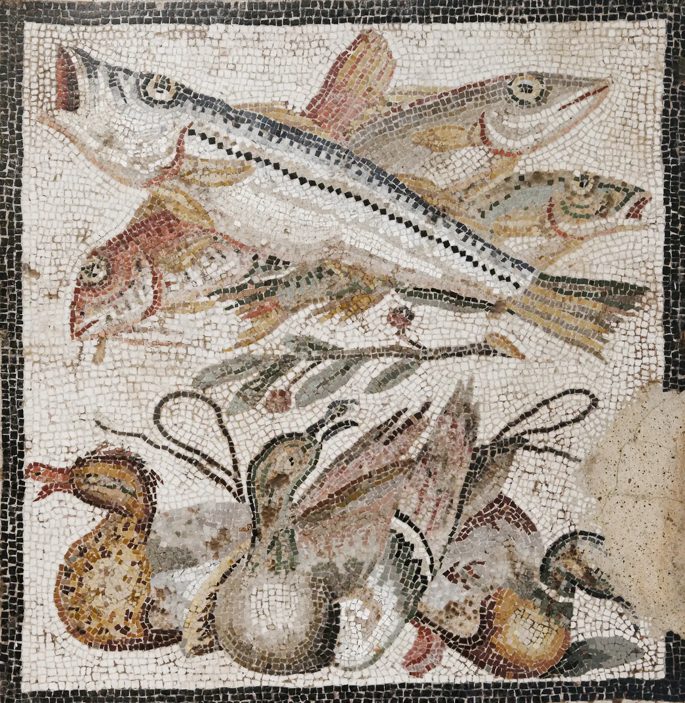

# ripple-pool

A Roman marine mosaic seen through a shallow pool of clear water, after Evan
Wallace's WebGL Water. A finger or pointer drawn across leaves a wake, a click
or tap drops a stone that sends out a train of rings, the rings run to the
walls and come back, and on a phone tilting it sloshes the whole basin. Left
alone it is still alive: a faint net of sunlight drifts across the floor, the
way it does in any shallow pool in the sun.

```html
<link rel="stylesheet" href="ripple-pool.css">
<figure data-ripple-pool>
  
</figure>
<script type="module" src="ripple-pool.js"></script>
```

The `` sizes the pool. Leave it at its natural ratio, or give the figure a
height and the img `object-fit: cover` (and any `object-position`); the water
takes exactly the same crop. `class="rp-bleed"` on the figure makes a full
screen of water (`100svh`). Or call `ripplePool(figure, options)` yourself; it
returns `destroy()`.

## Options

| attribute | option | default | |
|---|---|---|---|
| `data-damping` | `damping` | `3.5` | roughly how many seconds a disturbance takes to die away |
| `data-strength` | `strength` | `1` | scales every stone, wake and slosh |
| `data-rain` | `rain` | `7000` | ms between idle drops (jittered ±40%); `0` = never. The first comes 1.2 s after the pool is seen |
| `data-caustics` | `caustics` | `0.7` | 0-1, how strongly the ripples focus light onto the floor |
| `data-ambient` | `ambient` | `0.35` | 0-1, the sunlit swell and drifting caustic net when nobody touches it; `0` = off (the water is then perfectly still at rest, every tessera exactly the image) |

The options object wins over the attributes.

## Theming

| variable | default | |
|---|---|---|
| `--rp-tint` | the mosaic's own mean colour, darkened | colour that deeper water (troughs) leans toward |
| `--rp-glint` | `#fffaf0` | colour of the specular glint |
| `--rp-rim` | a hairline and a soft inset shadow | `box-shadow` where the water meets the edge; `none` to drop it |
| `--rp-floor` | `--paper-2` | behind the image while it loads |
| `--accent` | clay | keyboard focus ring |

There is deliberately no blue: the water is clear and the palette is the floor's.

## How it works

- **Water.** A height field of about 256 cells on the long side (never finer
  than 3 css px) is stepped on the CPU at a fixed rate: the wave equation plus a
  small surface-tension term (the laplacian of the laplacian), so short ripples
  run ahead and a stone sends a train of rings rather than one, and a touch of
  viscosity that takes out grid-sized ripples. Walls reflect. The step rate is
  set from the cell size so waves travel at the same 250 css px/s in a phone or
  a desktop pool, and stone heights scale with the grid so slopes look the same.
- **Texture.** Each frame the slope, light focus and height of every cell are
  packed into one small RGBA8 texture (128 = flat). No float textures, so it
  runs on any WebGL1.
- **Shader.** The mosaic is pre-cropped (`object-fit` honoured) into a texture
  at one texel per device pixel, so at rest it is sampled exactly. The floor is
  sampled where a ray bent by the surface lands; caustics are
  `1 / det(I + k · Hessian(h))`, the area a patch of light shrinks or grows to;
  a soft fixed light glints only off facets steep enough to catch it; troughs
  lean a little toward the depth tint.
- **Ambient swell.** Not simulated: five long, slow analytic waves in the
  shader. Their exact Hessian goes through the same `1 / det(I + kH)`, which
  gives the wobbly net of bright folds and dim cells, plus a pixel or two of
  refraction. Drawn at about 30 fps.
- **Light is tone-mapped** both ways (`1 - exp(-kx)`), with a shoulder above
  0.78 and less added light on pale stones, so bright bands warm white
  tesserae instead of burning them out, and the dimmed side carries contrast.
- **Wake.** The pointer is something pressed into the water to a fixed depth
  and drawn along (the water under it is pulled toward that depth, never past
  it), so a slow hand makes a gentle wake, a fast one a V, and neither runs away.
- **Stone.** A Gaussian-windowed cosine (crater, lip, fainter second trough),
  then the rebound and a smaller bob: it leaves as a train of three or four
  rings that spread past a third of the pool and come back off the walls.
  Stone radius is 3.4% of the pool's long side (14-56 px), and a small pool
  gets a proportionally gentler splash.
- **Tilt.** The change of tilt is added to the surface as a ramp; the walls turn
  it into a wave that runs across and back (`tilt.js`, shared, smoothed).

## Tuning

The constants at the top of `ripple-pool.js` are the physics: `WAVE` (speed),
`TENSION` (how much a stone rings), `VISCOSITY`, `REFRACT` (how far the floor
shifts, css px at the steepest slope), `FOCUS_K` (how hard light focuses).
The ambient net's wavelengths, speeds and fold depth (`f`) are in `swell()` in
the shader; shorter wavelengths make smaller cells.

Busy, high-contrast mosaics show the water best. A mosaic photographed at
around one tessera per 15-30 px of screen is ideal; the full-bleed demo image
is 3840 px wide so a 3x phone gets it nearly 1:1.

## Behaviour and cost

- **Ambient costs a light continuous loop while the pool is visible**: one
  full-screen draw about 30 times a second, no simulation (the sim only runs
  while the water is disturbed). Off screen or in a hidden tab, nothing runs.
- With `data-ambient="0"` the loop stops entirely once the water is still: the
  last faint shimmer settles quickly, about 6 s after the last touch. Rain
  waits on a `setTimeout`, not a loop, and pauses off screen and in a hidden tab.
- Canvas DPR is capped at 2, **except** on a 3x phone when the pool stays under
  ~3.4 megapixels (a full-screen 390x844 pool is 3.0), because the tesserae
  must be as sharp as the plain ``.
- The simulation costs well under a couple of ms a frame on a laptop; the shader
  is six texture reads and five sines a pixel.
- Without WebGL, or if the image is cross-origin (WebGL refuses it), the ``
  simply stays. If the GPU drops the context, the img shows again until it
  comes back.

## Accessibility and reduced motion

- The image is decorative (`alt=""`); the canvas is `aria-hidden`.
- With motion allowed the figure becomes focusable (`role="button"`, a default
  `aria-label` unless you set one): Enter or Space drops a stone, the arrow
  keys draw a wake across. Focus shows an accent ring.
- `prefers-reduced-motion: reduce`: the mosaic under a faint, frozen surface
  (two gentle rings caught part way out) and a frozen net of light. Nothing
  moves, there is no ambient loop and no rain, and touch does nothing.
- Touch scrolling is never blocked: the page scrolls over the pool as usual,
  and a finger resting on it as it scrolls past leaves a wake.
- Print shows the plain image.

## Credits

- After Evan Wallace's [WebGL Water](https://madebyevan.com/webgl-water/);
  no code from it is used.
- Images from Wikimedia Commons, see `assets/credits.json`
  (Milreu frigidarium: Carole Raddato, CC BY-SA 2.0; Naples fish and ducks:
  public domain).
