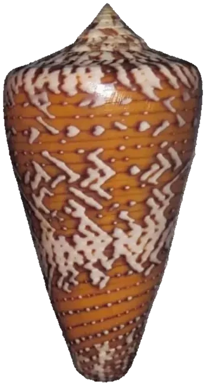
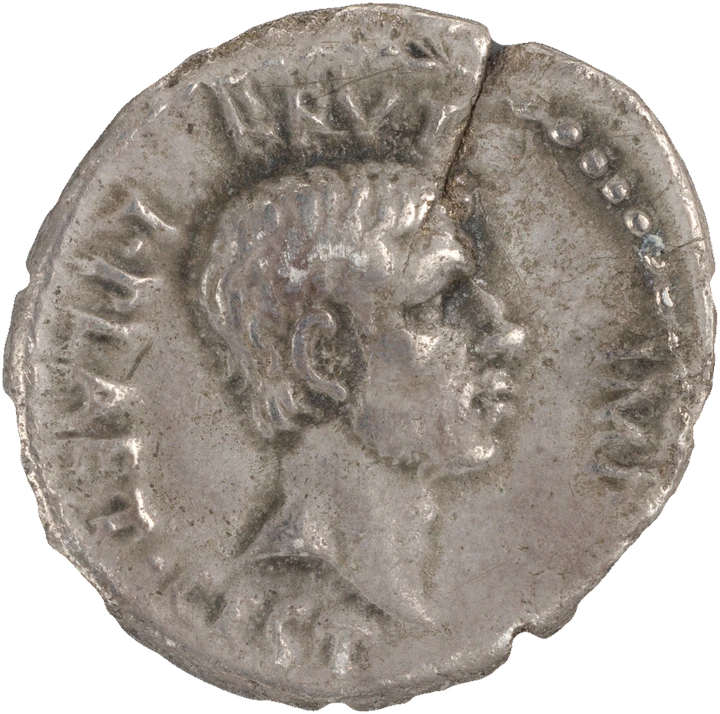

# specimen-tray

A naturalist's cabinet drawer of shells and coins you can handle. Scrolling into
the section pulls the drawer out from under a shelf edge; it has weight, stops
hard against its runners, and everything in it shivers once while the tags swing.
Then the objects are yours: pick one up and it lifts off the linen, throw it and
it slides, turns, knocks into its neighbours and the walls, and stops the way
things stop on cloth. Each one trails a paper tag on a red thread.

```html
<link rel="stylesheet" href="specimen-tray.css">
<section data-specimen-tray data-label="Tray IV">
  <div class="sp-stage">
    <ul class="sp-tray" aria-label="A drawer of shells and coins">
      <li data-no="0382" data-back="assets/cone-cedonulli-back.webp"></li>
      <li data-no="2210" data-size=".46" data-weight="2.6" data-back="assets/denarius-brutus-reverse.webp">
        </li>
      <!-- 8-16 objects -->
    </ul>
  </div>
</section>
<script type="module" src="specimen-tray.js"></script>
```

Images must be transparent cut-outs (webp or png with alpha), trimmed close.
The cabinet chrome goes in once every image has decoded; until then (and
without JS) the plain lined tray shows. An image that fails to load is left out.
The collision outline is the convex hull of each image's own alpha, read at
start-up, so any cut-out works without hand-made shapes. Load the hand font
(`Homemade Apple` from Google Fonts in the demo) before the script.

Without JS the same markup is a lined tray with the specimens laid out in a
grid. Or call it yourself: `import { specimenTray } from './specimen-tray.js'`
then `const destroy = specimenTray(section, { fill: .22 })`.

## Options

On the section (`data-*`) or in the options object (which wins).

| option | default | |
| --- | --- | --- |
| `label` | `""` | text on the brass card on the drawer front |
| `fill` | `0.2` | share of the lining the objects cover; sets their size at any screen width |
| `min-size` | `68` | px. Below this, objects are left out (at random) rather than shrunk; phones show fewer |
| `max-size` | `210` | px cap on an object's long side |
| `friction` | `1` | 1 is linen on felt; 0.5 slides twice as far |
| `tags` | `true` | `false` for loose objects without tags or threads |
| `seed` | random | a number gives the same arrangement every load (stills, tests) |

Per object (`<li data-*>`):

| attribute | |
| --- | --- |
| `data-no` | catalogue number written on the tag and read out with the name |
| `data-weight` | density; coins at ~2.5 shove shells aside, shells barely move a coin |
| `data-size` | relative size (1 = the computed size; 0.7 for a small coin) |
| `data-back` | image for the other side, shown when it is turned over (otherwise the same face, mirrored) |

## Theming

Custom properties on `[data-specimen-tray]`: `--sp-lining` (#e3dac8, the linen),
`--sp-wood` / `--sp-wood-2` (ebonised frame), `--sp-thread` (defaults to
`--accent`), `--sp-tag-ink`, `--sp-brass`, `--sp-hand` (tag font),
`--sp-wall`, `--sp-front-h`, `--sp-shelf-h`, `--sp-width` (1180px), and
`--sp-weave` / `--sp-grain` (the SVG-noise textures). Paper and gutter come from
the house `--paper` and `--gutter`.

## Tuning notes

- The section is a `240svh` runway with a pinned stage; the drawer is fully out
  about 40% of the way through, leaving most of the pin to play.
- The drawer is a spring (k 36, c 10.5) aimed 14% past its stops, so it always
  arrives with speed and hits them; the shiver scales with that speed.
- Felt is Coulomb friction (2300 px/s²), not damping: a hard throw goes about
  half a desktop drawer and stops dead. Rotation brakes by the same law.
- A drag is a soft spring at the grab point (7 Hz, damping 0.95). Grab a long
  shell by its tip and it swings round to trail the finger.
- Tags are verlet: seven thread points (rope that only pulls) and a rigid card.
  The card glides a little more than the thread, which is why it swings.
- The drawer slides in 3D only while moving; at rest its transform is removed so
  everything is rasterised flat and sharp.
- The loop stops when everything is still or the section is off screen.

## Accessibility and reduced motion

Each `` is wrapped in a real `<button>` named from its catalogue number and
alt text, with a described-by hint. Tab moves through the objects (the focused
one rises a little and gets a clay ring), arrow keys nudge it across the felt
(Shift pushes harder), Enter or Space turns it over, and an `aria-live` line
says so. Double-click turns over too. Tags, threads, shelf and drawer chrome are
`aria-hidden`.

`prefers-reduced-motion: reduce`: no runway; the drawer is open from the start,
nothing moves by itself, turning over is instant, arrows step the object 12px,
and dragging still works but the object stays exactly where you let it go.

## Credits

- [rough.js](https://roughjs.com) by Preet Shihn, MIT, in `vendor/roughjs/`
  (unmodified, see VERSION and LICENSE). Draws the sketchy tags.
- Homemade Apple by Font Diner (Google Fonts, Apache 2.0).
- Images: the shells and the beetle are from Wikimedia Commons; the seven
  coins (each with its real reverse) are from The Metropolitan Museum of Art's
  Open Access collection (CC0). All are cut out from the original photographs;
  sources and licences in `assets/credits.json`.

## The demo's drawer

Fourteen specimens: a nautilus (Edward Weston's photograph), a *Conus
cedonulli* with its back, four views of tiger cowries, a turban shell, a
soldier beetle, and seven Greek, Roman and Parthian silver and gold coins. All
fourteen fit at 390px; on anything smaller than `min-size` allows, a random few
sit out. The arrangement is new on every visit.
Coins and the cone turn over to their real other face; the rest turn over to a
mirror image of the same face (fine for a beetle or a nautilus, a cheat for the
cowrie).
