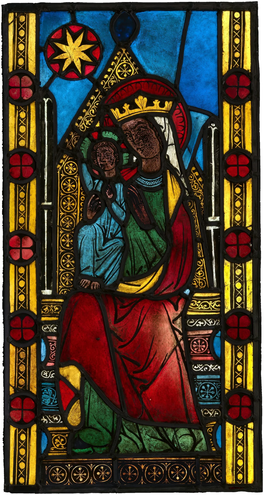

# stained-glass

Sunlight through a real medieval glass panel, landing on the page in colour.
The panel stands in the page like a window, glowing; its light lies across the
essay as a skewed, stretched patch of ruby, cobalt, emerald and gold. Near the
sill the lead lines are crisp dark seams and you can almost read the figure;
further out the seams thin and vanish and the colours run together into pools,
as they do on a church floor. Paper takes the colour of the glass, ink under the
light is tinted, and a cloud now and then dims the window and its light together
and softens every edge. As you read on, the day moves: the sun swings and lowers,
the patch slides across the paragraphs and warms toward afternoon. Dust in the
beam glints in whatever colour it floats through. On a phone, tilting it nudges
the sun.

The demo uses a pair of lights from the convent church at Altenberg an der Lahn
(German, c. 1290–1300, now at The Cloisters): the Virgin and Child under the
star, and the three kings. Each visit shows one of them.

```html
<link rel="stylesheet" href="stained-glass.css">

<!-- on the screen: the page scrolls under the light (fades out when the article leaves) -->
<article data-stained-glass data-attach="viewport">
  <figure class="window"></figure>
  … the essay …
</article>

<!-- on one section: the light belongs to it and scrolls with it -->
<section data-stained-glass data-glass="assets/adoration-three-kings.webp" data-sun="-40 30">…</section>

<script type="module" src="stained-glass.js"></script>
```

The panel is a cut-out with alpha (a `.webp` or `.png` on the same origin: WebGL
refuses cross-origin images). The component reads it from the host's own
`img[data-sg-glass]`, which it also dresses as the window (above the light and
out of the room's shade, set into the page by a hairline), or from `data-glass`.

Or call it yourself:

```js
import { stainedGlass } from './stained-glass.js';
const glass = stainedGlass(el, { sun: [-50, 30], clouds: .6 });
glass.set({ sun: [-40, 26], warmth: .7 });   // live
glass.state;                                  // { running, visible, presence, motes, drift }
glass();                                      // destroy: canvases, listeners, loop
```

The canvases never take input (`pointer-events: none`); text stays selectable.
Without JS the panel is a plain picture in the page and there is no light.

## Options

On the element (`data-*`) or in the options object, which wins.

| attribute | option | default | |
|---|---|---|---|
| `data-glass` | `glass` | the host's `img[data-sg-glass]` | URL of the panel: a cut-out with alpha, same origin |
| `data-sun` | `sun` | `-50 30` wide, `-14 38` tall | azimuth and elevation in degrees. Azimuth is on the screen: 0 = light from the top, -90 = from the left. Elevation is above the page; lower is longer |
| `data-at` | `at` | `.7 .62` wide, `.66 .74` tall | where the middle of the patch lands, as fractions of the area. Tune it with `sun` so the crisp sill end lies just beside your window |
| `data-size` | `size` | `1` | scales the patch. By default its area is 1.6 × the panel's area on the page (or, with no panel in the page, its length is half the area's diagonal) |
| `data-softness` | `softness` | `5.5` | penumbra. `1` is the bare 0.53° disc of the sun; more adds the bright aureole and puts the window further from the floor |
| `data-clouds` | `clouds` | `.45` | 0-1. A slow breath of a few percent, and now and then a cloud that dims the window and its light by 35-65% over five to ten seconds and softens every edge. The first comes 7-11 s in |
| `data-warmth` | `warmth` | `.35` | 0-1, colour temperature of the sun from 5900 K to 3400 K. Drift adds to it |
| `data-intensity` | `intensity` | `1` | scales the light (the screen lift) |
| `data-depth` | `depth` | `1` | 0-1.4, how deeply the glass colours the paper (the multiply) |
| `data-shade` | `shade` | `.19` | 0-1, the room's shade: a warm multiply (at .19, 0.91 0.87 0.81: sandstone, old vellum), deepest round the beam and beyond it and easing to about 0.97 far from it, so the sunlit patch can be brighter than the floor round it |
| `data-haze` | `haze` | `.25` | 0-1, coloured shafts in the air above the page |
| `data-motes` | `motes` | `.4` | 0-1, dust in the beam; `0` = none (and a cheaper loop) |
| `data-drift` | `drift` | `.7` | 0-1. The day moves on as you scroll through the host: the sun swings up to 18° and lowers up to 12°, and warms |
| `data-tilt` | `tilt` | on | `off` ignores the phone's tilt (otherwise up to ±7° of azimuth and ±5° of elevation) |
| `data-static` | `static` | off | a frozen beam: one frame, no loop, no motes |
| `data-attach` | `attach` | `viewport` on `<body>`, else `element` | `viewport`: fixed to the screen, fading out as the host leaves it. `element`: covers the element and scrolls with it |
| `data-seed` | `seed` | `7` | the dust |

## How it works

- **The window is in a wall.** As in `light-rays`, a page point maps back (an
  affine inverse) to the point `(u, v)` on the panel its ray came through, `v`
  being the height above the sill. The ray's length is `v / sin(elevation)`, and
  the sun's 0.53° disc seen from the page covers a disc of radius
  `length × 0.0093 / 2 × softness` on the panel. The light at the page point is
  the panel's transmittance averaged over that disc. So the bottom of the panel
  lands at the sill, crisp, and its top lands furthest out, blurred; the image
  on the floor is the window turned over, as it really is.
- **A colour blur stack.** The panel is drawn once into a canvas with a clear
  112-texel margin, linearised (`rgb^2.2`) and premultiplied by its alpha, then
  blurred by discs of growing radius (80-tap Vogel spiral, each level from the
  last): 0, 2.5, 7, 17, 40 and 92 texels, the later levels at half, a quarter, an
  eighth and a sixteenth of the size, like mipmaps. Each pixel reads the two
  levels either side of its own penumbra and mixes them. Blurring in linear
  light is what makes colours mix as light does: ruby and cobalt meet in a
  violet, not a brown.
- **The room is in shade, the patch is lit.** A church floor glows with colour
  because the sunlit patch is several times brighter than the shaded floor
  round it. So the multiply layer puts the whole area in the room's shade
  (warm, 0.91 0.87 0.81 at its deepest round and beyond the beam, a broad soft
  gradient easing to about 0.97 far from it), and where sun comes through the glass lifts the
  paper back to its own brightness, filtered by the glass's colour (normalised
  to its brightest channel). The screen layer then adds the light itself in
  that colour, through a filmic shoulder `1 - e^-1.25x`, with halation (16 taps
  of a quarter-resolution light map 7 and 20 px out), coloured shafts (12 taps
  toward the sun) and a fine, still grain. Gold, clear and pale glass end up
  brighter than the paper outside; dense ruby and cobalt stay at or below it,
  as they do in life. Ink under the light takes its tint.
- **Crisp at the sill, mixed and pale far out.** The blur radius drives the
  rest. Near the sill the colours are full and the lead and paint read as dark
  seams against the glass beside them (local contrast against the 40-texel
  level: the eye adapted to the bright patch). As the penumbra grows the seams
  vanish into the blur, the colours lose up to 45% of their saturation, and
  the light is lifted a little (the averaged-in lead no longer shows), so the
  far end is soft rose, straw, lavender and sea-green, mottled, not blobs.
- **The window in the page** sits above the light (`z-index` one higher), so it
  is neither lit by itself nor in the room's shade: against the shaded page it
  glows. A hairline and the faintest drop shadow set it into the page. It
  follows `--sg-sun` (set by the script, 1 in full sun): a cloud dims and
  flattens the glass with its light.
- **Clouds** dim the light, cool it slightly (+900 K), widen every penumbra
  (the sun's disc swells into haze) and dim the window.
- **Dust.** A few hundred motes drift on a divergence-free current (the curl of
  drifting sines), rise a little and jostle. Each looks up the light map where
  its own ray reaches the page and glints in that colour; like real dust they
  show against ink and almost vanish on bright paper.
- **Drift and tilt.** Scroll progress through the host moves the sun on a soft
  spring; a tilt of the phone (`tilt.js`, copied from `ripple-pool`) adds a
  little more, smoothed.

## Tuning

- `LEVELS` and `PAD` at the top of the script are the blur stack; `LEN` is the
  patch length; `SKEW` (20°) the lean of the wall.
- Colour: `uGain` (1.5, the exposure: the photographed glass is darker than
  sunlight through it), `uDeep` (0.8, how deeply the glass colours the lit
  paper), `uSeam` (0.62, the lead and paint shadows near the sill), `uPale`
  (0.55, saturation left at the far end), `far` in the shader (6-80 texels, where
  the light goes from crisp to mixed) and `sunColour()` (0.62, the lift).
- `AREA` (1.6) is the patch's area as a multiple of the panel's.

## Theming

The light has no colours to theme beyond `warmth`: it is sunlight through the
glass you give it. On a dark page (read from the host's or body's computed
`background-color`) the multiply is far gentler and the light becomes a
coloured glow. The demo is always on warm paper, in the room's shade.

| variable | default | |
|---|---|---|
| `--sg-z` | `3` | z-index of the canvases; the window is drawn at `--sg-z + 1`. Raise it if other positioned content should sit under the light |
| `--sg-sun` | set by the script | 0-1, how much sun is on the window now; use it to dim anything else that should follow the weather |

## Accessibility and reduced motion

- The canvases are `aria-hidden`, have `pointer-events: none`,
  and never block input, selection or scrolling. Nothing is focusable. The
  panel image in the demo is decorative (`alt=""`, `aria-hidden`).
- `prefers-reduced-motion: reduce`: one still frame with the whole patch, no
  dust, no clouds, no drift, no tilt.
- Text in the light keeps its contrast: ink is tinted, never lifted above a
  dark tone; keep `intensity` near 1 for running text.
- Print hides the light and leaves the panel.

## Cost

- About 30 fps while a cloud breathes, 60 while dust drifts; nothing runs once
  a viewport light has faded out, in a hidden tab, or for an element light off
  screen. With `data-static`, reduced motion, or `clouds` and `motes` at 0 it
  draws once and stops (scrolling with drift redraws on a spring, then stops).
- DPR capped at 2, and lower for very large areas (4.6 Mpx a frame at most).
  Each pixel reads the six stack levels twice (two passes) plus 28 taps of the
  quarter-resolution light map in the screen pass.
- The stack is about 20 MB of GPU memory (1024 × ~2000 at full size, then
  shrinking), built once in a few milliseconds.
- Without WebGL a single 2D canvas (blended multiply) lays a still, softened
  picture of the panel along the same projection. If the GPU drops the context
  the light goes out and comes back with it.

## Credits

- *The Adoration of the Magi*, two panels, German (Altenberg an der Lahn),
  c. 1290–1300, pot-metal glass and vitreous paint: The Metropolitan Museum of
  Art, The Cloisters Collection, 2003. Open Access (CC0). Cut out from their
  black photographic backgrounds along their own outer lead cames. Details in
  `assets/credits.json`.
- Geometry, loop, dust and weather adapted from this factory's `light-rays`;
  `tilt.js` from `ripple-pool`. Colour temperature after Tanner Helland's
  blackbody fit. No third-party code.
