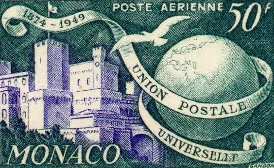
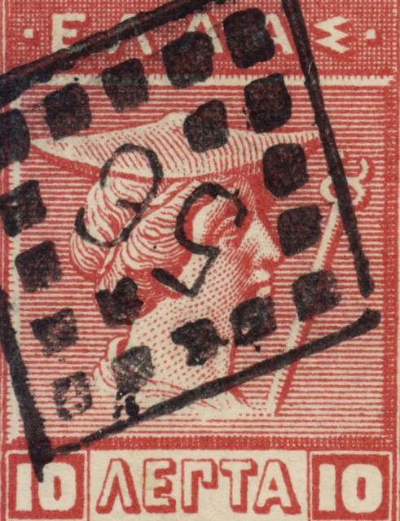

# stamp-tear

A pane of real stamps printed on one perforated sheet, and a stockbook page
beside it. Grab a stamp and pull. The paper resists: the stamp gives a few
pixels, the bridges between the holes stretch and the holes around it darken.
Then the perforation unzips from your grip outward, and the stamp comes away
with half-hole teeth and torn fibres. It hangs from the point you hold and
swings like a card held by its corner. Let go over the album and it slides
into the nearest empty pocket of a glassine strip, straightened, and only
then gets its colour (the sheet is printed at `grayscale(.86) sepia(.24)
contrast(.84)`). The sheet keeps the gap.

```html
<link rel="stylesheet" href="stamp-tear.css">
<div data-stamp-tear>
  <ul class="st-sheet">
    <li data-name="Monaco 1950, 50 francs"></li>
    <!-- … any number; 12 makes a 4 × 3 pane (3 × 4 on a phone) -->
  </ul>
  <div class="st-album">
       <!-- optional singles -->
  </div>
</div>
<script type="module" src="stamp-tear.js"></script>
```

Crop each image to just the printed design, with the scan's own
perforations and margin trimmed off. The script prints the white border,
the perforations and the torn teeth itself, so every stamp on the sheet
matches. The sheet takes its shape from the designs: the short side always
has 12 holes, and the long side gets however many give an even white margin
around the median design aspect. A 10:13 portrait comes out 12 × 15, and the
wide Monaco airmail 18 × 12. If designs on one sheet differ a little, each is
cover-cropped to fit. Keep a pane to one design. The demo is a se-tenant
pane of the four 1950 Monaco UPU values: one design, four colours, so the
sheet reads as one pane and the album fills with four different colours. `data-name` on an `li` becomes that stamp's
accessible name; without it the name is "Stamp 3 of 12".

``s placed inside `.st-album` are **singles**: they appear already
mounted, in colour, each perforated at its own shape and true size (same
gauge as the sheet) and torn all round. They fill the first strip or two of
the page, and the pane's pockets follow below. Use them for
odd stamps (a used one, another country, another shape) that would look
wrong repeated on a mint sheet. New sheet leaves them where they are.

| Attribute | Default | |
| --- | --- | --- |
| `data-threshold` | `64` | px of pull before the perforations give (85% of that on touch) |
| `data-give` | `5` | px a stamp shifts in the sheet while resisting |
| `data-unzip` | `150` | ms for the bridges to snap, grip outward |
| `data-gravity` | `5200` | px/s² for the hanging swing (higher swings faster) |
| `data-swing` | `0.16` | damping ratio of the swing (1 = no overshoot) |
| `data-cols` | `0` | sheet columns; 0 = 4 where there is room, else 3 |
| `data-max` | `128` | largest portrait stamp width in px (wider shapes get proportionally more) |
| `data-aspect` | `0` | design width / height; 0 = read it from the sheet's images |
| `data-plate` | `Nº 1` | plate number in the top margin (`''` for none) |
| `data-hint` | `Pull a stamp free` | small label under the sheet (`''` for none) |

JS: `import { stampTear } from './stamp-tear.js'; const destroy = stampTear(el, { unzip: 200 });`
Options passed in the object win over data attributes. `destroy()` puts the
original `ul` back as it was and removes every listener, observer and added
element.

## Theming

On `[data-stamp-tear]`:
`--st-card` (stamp paper, `#fcfaf4`), `--st-leaf` (album cloth, `#222b26`),
`--st-leaf-ink` (folio numerals), `--st-muted` (the filter for stamps still on
the sheet), `--st-under` (what shows through the holes) and `--st-page` (what
shows through a torn gap; defaults to `--paper`). It also reads the shared
`--paper`, `--ink-2`, `--ink-3`, `--rule`, `--accent`, `--serif` and `--sans`.

Layout: below 920px wide the album sits under the sheet. From 920px up, the
sheet and the album sit side by side. Stamp size follows the container. The
album page is charcoal-green book cloth (`--st-leaf`) with slim glassine
strips. It holds exactly one pocket per sheet stamp plus one per single,
each cut snug to its stamp at about two thirds size, so the page stays
smaller and quieter than the sheet. Rows are split as evenly as possible, so
no strip is left holding a single lonely pocket.

## How it is built

- **Perforations are masks, not drawings.** Each stamp is masked with half
  holes around all four edges (one SVG mask shared by every cell). Two
  neighbours side by side make whole holes, and the paper between them is
  the bridge. A torn stamp's edge is therefore exactly the half-hole edge it
  had on the sheet. The margin is a second mask: a frame with half holes on
  its inner edge, and the perforation lines carried out through it as on a
  real line-perforated sheet.
- **Strain** is a canvas over the pane, drawn only while a stamp is pulled.
  Each bridge is a necked strip of paper spanning the seam, and each hole
  (and the slot it opens into) fills with shadow, weighted towards your grip.
  At the threshold the bridges are sorted by distance from the grip and
  snapped on a schedule, with a short recoil stub each.
- **Torn fibres** are SVG: a ragged tip and one to three hairs on every
  tooth, seeded so they stay the same across resizes. They appear on both
  sides of the tear: the stamp, its neighbours and the margin.
- **The swing** is a physical pendulum. The card has its real moment of
  inertia (`(w² + h²)/12`), and it hangs from the grip under gravity minus
  the hand's acceleration: `I·θ'' = r × (g − a) − c·θ'`, with a little
  quadratic air drag. The hand is followed through a stiff spring, so the
  acceleration is smooth even when pointer events are not. Grip a corner and
  it swings wide; grip the middle and it barely turns.
- **Settling** uses plain damped springs. Pockets are critically damped with a
  slightly softer angle, so the stamp straightens with the faintest settle.
  A stamp dropped on the page keeps a fifth of its tilt (at most 6°).
- The rAF loop runs only while something moves or a finger is down, and
  settles anything in flight at once if the piece scrolls off screen. Carry
  a stamp to the top or bottom edge of the screen and the page scrolls with
  you, which is how the album is reached on a phone.

## Accessibility and reduced motion

Each stamp is a focusable `role="button"`. Enter or Space tears it and
carries it to the next free pocket along a short arc, with the same physics.
Focus then moves to the next stamp on the sheet (or to New sheet). An
`aria-live` line reports "Stamp 3 of 12 mounted. 4 of 12 in the album."
Images are decorative (`aria-hidden`). The margin marks, fibres and canvas
are `aria-hidden`. With `prefers-reduced-motion`, dragging still works: the
stamp hangs at its rest angle without swinging, tears at once and drops
straight into place. Keyboard mounting and New sheet are instant. Without JS
the list is a quiet grid of muted stamps, and the album is hidden.

On phones that support it (Android Chrome), the moment of tearing gives an
8ms `navigator.vibrate` tick, and only after a real touch. iOS has no
vibration API, so there it is silent.

## Credits

No libraries. Stamp images are from Wikimedia Commons; see
`assets/credits.json`.
